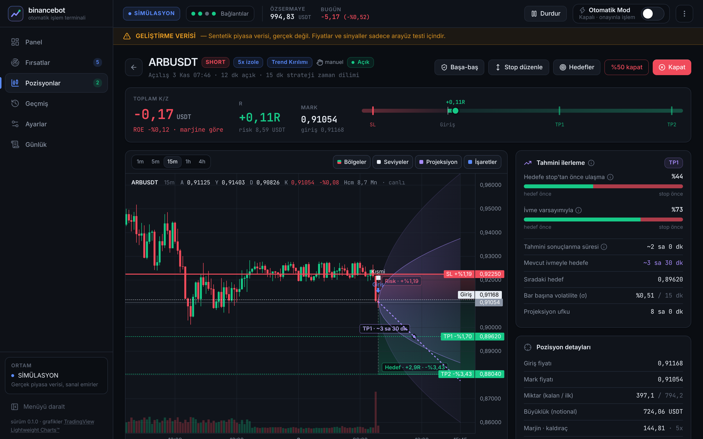
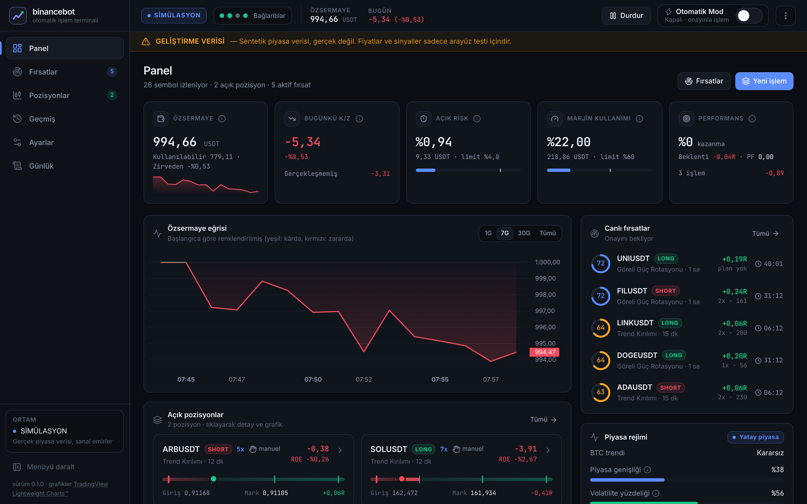
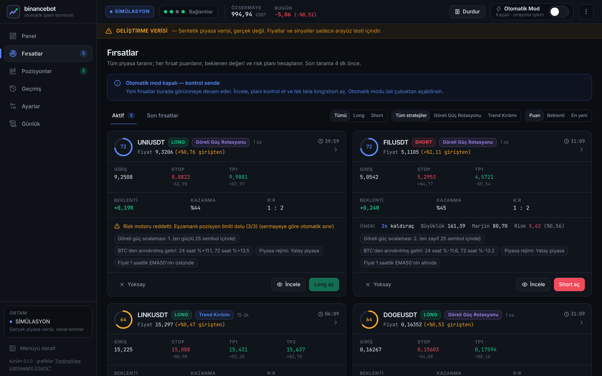

# binancebot

Binance USDⓈ-M Futures için **risk öncelikli, tam otomatik** işlem sistemi ve profesyonel kontrol paneli.

> [!WARNING]
> Kaldıraçlı işlemler yüksek risk içerir; yatırdığın paranın tamamını kaybedebilirsin. Bu proje kazanç garantisi vermez. Önce **Simülasyon**, sonra **Testnet**, en son küçük sermayeyle **Canlı** kullan.

📘 Tasarım ve gerekçeler: [YAPIM_KILAVUZU.md](YAPIM_KILAVUZU.md) · 🔌 API: [docs/API.md](docs/API.md)

## Ekran görüntüleri

> Görüntüler **sentetik geliştirme verisiyle** alınmıştır (üstteki sarı uyarı şeridi). Fiyatlar ve sinyaller gerçek piyasa değildir.

**Pozisyon detayı:** SL/TP bölgeleri, likidasyon çizgisi, volatilite konisi ve ivme yolu (tahmini ilerleme), hedef olasılıkları



**Panel**



**Fırsatlar:** Otomatik mod kapalıyken fırsatlar burada onayını bekler



## Neler yapar?

- **Tüm USDT perpetual kontratları** gerçek zamanlı tarar. Binance'in 2026 WebSocket yapısını (`/market`, `/public`, `/private`) kullanır.
- **Fırsat stratejileri:**
  - S1 Trend Kırılımı (15 dk): 15 dk / 1 sa / 4 sa trend uyumu, log-hacim teyidi
  - S2 Göreli Güç Rotasyonu (1 saat)
  - S3 Ortalamaya Dönüş (yatay piyasa; varsayılan kapalı, önce backtest)
  - Piyasa rejimi filtresi ve open interest teyidi
  - Her fırsat için puan ve tahmini beklenti (EV) hesaplanır. Backtest kalibrasyonu uygulanınca EV ölçülmüş istatistiklere dayanır.
- **Backtest:**
  - Aynı strateji ve risk koduyla geçmiş veride test yapılır; komisyon, kayma ve gerçek funding geçmişi hesaba katılır.
  - Sonuçta Monte Carlo düşüş dağılımı, dönemsel tutarlılık, R dağılımı, aylık getiriler ve strateji/yön kırılımı yer alır.
  - Tek tıkla kalibrasyon uygulanabilir.
- **Analiz paneli:** Fırsat, pozisyon ve manuel işlem ekranlarında bulunur.
  - Zaman dilimi tablosu: trend, RSI, ADX, ATR, Bollinger %B, hacim.
  - Funding, OI değişimi, likidasyonlar, spread ve BTC korelasyonu/betası.
  - Türkçe özet notlar.
- **Kasa yönetimi (sermayeye oranlı):**
  - İşlem riski özsermayenin yüzdesidir.
  - Kaldıracı sistem önerir: büyüklüğü marjin bütçesine sığdıran en düşük değer, likidasyon stop'tan en az 3 kat uzakta.
  - Portföy, korelasyon ve marjin limitleri, devre kesiciler.
- **Otomatik mod aç/kapa:** Kapalıyken fırsatlar panele düşer, sen tek tıkla işlem açarsın. Ayrıca istediğin sembolde **manuel işlem bileti** var.
- **Pozisyon detayı:**
  - Canlı grafik, SL/TP bölgeleri, likidasyon çizgisi.
  - **Tahmini ilerleme:** volatilite konisi, ivme yolu, hedef olasılığı, tahmini süre.
- **Borsada duran stop** (Algo API, MARK_PRICE), TP merdiveni, başa-baş, iz süren stop, zaman stopu ve otomatik mutabakat.
- **Ortamlar:** Simülasyon (gerçek veri + sanal emir) · Testnet · Canlı.
- **Ayarlar arayüzden:** API anahtarları ve Telegram token sunucuda **şifreli** saklanır, tarayıcıya asla geri gönderilmez.
- **Telegram:** Bildirimler, günlük rapor ve komutlar (`/durum`, `/pozisyonlar`, `/otomatik_ac`, `/otomatik_kapat`, `/durdur`, `/devam`).
- **Koruma katmanları:**
  - İşlem öncesi spread kontrolü.
  - Strateji sağlık monitörü: performansı bozulan stratejiyi otomatik kapatır.
  - Devre kesiciler: günlük/haftalık zarar, maksimum düşüş, kayıp serisi.
- **Ücretli API yok:** Yalnızca Binance'in ücretsiz API'leri ve açık kaynak yazılım kullanılır.

## Hızlı başlangıç (Docker — önerilen)

Sunucuda (sabit IP'li bir VPS önerilir; ABD bölgeleri Binance tarafından engellenir):

```bash
git clone https://github.com/ahmetnebii/binancebot.git
```

```bash
cd binancebot
```

```bash
docker compose up -d --build
```

Panel güvenlik için yalnızca sunucunun kendisinde (`127.0.0.1:8000`) açılır. Kendi bilgisayarından SSH tüneliyle bağlan:

```bash
ssh -L 8000:127.0.0.1:8000 kullanici@SUNUCU_IP
```

Sonra tarayıcıda **http://localhost:8000** adresini aç.

## Kendi bilgisayarında çalıştırma (Docker'sız)

Gerekenler: **Git**, **Python 3.11+**, **Node.js 18+** (20+ önerilir).

macOS / Linux:

```bash
git clone https://github.com/ahmetnebii/binancebot.git
cd binancebot
python3 -m venv .venv
.venv/bin/pip install -r backend/requirements.txt
cd frontend && npm ci && npm run build && cd ..
cd backend && ../.venv/bin/python -m app
```

Windows (PowerShell). Komutları **tek tek** çalıştır; Windows PowerShell `&&` desteklemez:

```powershell
git clone https://github.com/ahmetnebii/binancebot.git
cd binancebot
py --version                      # 3.11 veya üstü olmalı
py -m venv .venv
.venv\Scripts\python -m pip install -r backend\requirements.txt
cd frontend
npm ci                            # "running scripts is disabled" hatası alırsan: npm.cmd ci
npm run build                     # aynı durumda: npm.cmd run build
cd ..\backend
..\.venv\Scripts\python -m app
```

Sonra tarayıcıda **http://localhost:8000** adresini aç. Port doluysa `--port 8080` ekle.

**Güncelleme:** Proje klasöründe `git pull` çalıştır, ardından `frontend` içinde `npm ci && npm run build` yap ve sunucuyu yeniden başlat. Docker kullanıyorsan `docker compose up -d --build` yeterli.

> Ev bilgisayarında canlı/testnet işlem yapacaksan API anahtarının IP kısıtlamasına ev IP'ni eklemelisin. Ev IP'si değişebildiği için 7/24 canlı işlem için sabit IP'li bir VPS önerilir. Simülasyon ve backtest için anahtar gerekmez.

## İlk kurulum

1. **Parola oluştur:** İlk açılışta panel parolası istenir (en az 10 karakter).
2. **Simülasyonla başla:** Varsayılan ortam budur ve anahtar gerekmez. Başlangıç bakiyesini **Ayarlar → Simülasyon** bölümünden ayarla. Sistem gerçek piyasa verisiyle sanal işlem yapar.
3. **Testnet:** Binance demo/testnet hesabından anahtar al. **Ayarlar → Bağlantı → Testnet** bölümünde anahtarları gir ve **Bağlantıyı test et** butonuna bas.
4. **Canlı:** Yeni bir API anahtarı oluştur. **Çekim yetkisi KAPALI**, **IP kısıtlaması AÇIK** (sunucunun IP'si) olmalı. **Ayarlar → Bağlantı → Canlı** bölümüne gir ve onay için `CANLI` yaz.
5. **Telegram:**
   - @BotFather'dan bot oluştur ve token'ı **Ayarlar → Telegram** bölümüne kaydet.
   - Bota bir mesaj gönder, sonra **Chat ID bul** butonuna bas.
   - **Test mesajı** gönderip çalıştığını doğrula.
6. **En iyi ayarları bul (önerilir):** **Backtest** sayfasının üstündeki **En iyi ayarları bul** butonuna bas (180 gün, Normal derinlik). Sistem arka planda 4 stratejiyi (S1 kırılım, S2 göreli güç, S3 ortalamaya dönüş, S4 4 saatlik trend takibi, S5 grafik formasyonları: omuz-baş-omuz, ikili tepe/dip, üçgen), yön izinlerini, rejim filtresini, funding sınırını, çıkış profilini ve parametreleri iki aşamada dener; geçmişin ilk 2/3'ünde seçer, son 1/3'ünde (hiç görmediği dönem) doğrular. Sonuç "Önerilen" ise **Bu ayarları uygula** de; tarama bundan sonra bu ayarlarla fırsat arar. "Avantaj yok" derse otomatik modu açma. Sayfayı kapatabilirsin, iş sunucuda sürer.
7. **Otomatik mod:** Üst çubuktaki anahtarla aç veya kapat. Ortam değiştiğinde güvenlik için kendiliğinden kapanır.

## Geliştirme (Docker'sız)

```bash
python3 -m venv .venv
```

```bash
.venv/bin/pip install -r backend/requirements-dev.txt
```

```bash
cd backend && ../.venv/bin/python -m pytest -q
```

```bash
cd backend && ../.venv/bin/python -m app
```

Arayüz (ayrı terminalde; `/api` ve `/ws` istekleri 8000 portuna yönlendirilir):

```bash
cd frontend && npm install && npm run dev
```

Binance'e erişimin olmadığı bir ortamda arayüzü denemek için **yalnızca geliştirme amaçlı** sentetik veri kullanılabilir. Bu veri gerçek piyasa değildir. Panelde kalıcı bir uyarı gösterilir ve sistem zorunlu olarak simülasyonda kalır:

```bash
cd backend && BB_DATA_SOURCE=synthetic ../.venv/bin/python -m app
```

## Ortam değişkenleri

| Değişken | Varsayılan | Açıklama |
|---|---|---|
| `BB_DATA_DIR` | `./data` | Veritabanı ve `master.key` (birlikte yedekle) |
| `BB_HOST` / `BB_PORT` | `127.0.0.1` / `8000` | Dinlenen adres |
| `BB_MASTER_KEY` | — | Şifreleme ana anahtarı (verilmezse `data/master.key` üretilir) |
| `BB_COOKIE_SECURE` | `0` | HTTPS ters proxy arkasında `1` |
| `BB_DATA_SOURCE` | `binance` | `synthetic` yalnızca geliştirme içindir |

## Güvenlik notları

- `data/master.key` kaybolursa kayıtlı anahtarlar çözülemez ve yeniden girilmeleri gerekir. `data/` klasörünü yedekle ama asla Git'e ekleme.
- Paneli internete açacaksan HTTPS (ör. Caddy) ve güçlü bir parola kullan; `BB_COOKIE_SECURE=1` ayarla.
- Kaydedilen API anahtarı ve token arayüze bir daha gösterilmez, sadece son 4 karakteri görünür.

## Durum ve bilinen sınırlamalar (v0.2)

- Binance bağlantı katmanı resmi API formatlarına göre yazıldı ve birim testleriyle doğrulandı. Ancak gerçek Binance'e karşı ilk uçtan uca test **senin sunucunda** yapılacak, çünkü geliştirme ortamının Binance'e erişimi yoktu. Sıra: **Backtest (gerçek veri) → Simülasyon → Testnet → küçük Canlı**.
- Testnet/demo adresleri ve WebSocket yolları **Ayarlar → Bağlantı → Gelişmiş** bölümünden değiştirilebilir.
- Geliştirme ortamındaki backtest'ler sentetik veriyle yapıldı ve gerçek performans hakkında bilgi vermez. Stratejilerin gerçek avantajını kendi sunucunda gerçek Binance verisiyle backtest çalıştırarak ölç ([kılavuz Bölüm 26.5](YAPIM_KILAVUZU.md)).
