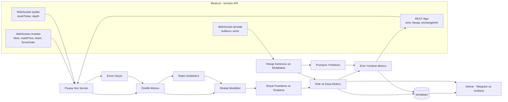
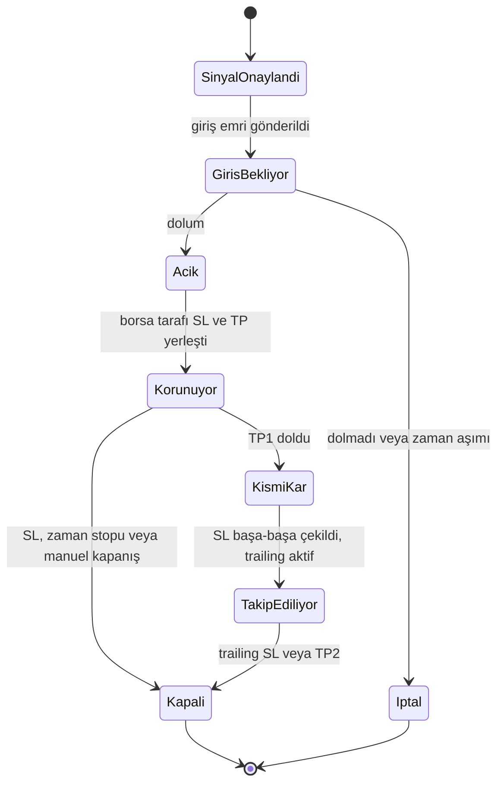

# 🤖 Binance Futures Otomatik İşlem Botu — Yapım Kılavuzu

| | |
|---|---|
| **Sürüm** | 1.1 |
| **Tarih** | 3 Kasım 2026 |
| **Durum** | v0.1 uygulandı: tarama, stratejiler, risk motoru, simülasyon/testnet/canlı broker, kontrol paneli (bkz. Bölüm 26) |
| **Kapsam** | Binance USDⓈ-M Perpetual (USDT marjinli) vadeli işlemler |

> **Özet**
> - Tüm USDT perpetual kontratları **gerçek zamanlı tarayan**, fırsatları **puanlayıp en iyilerini seçen**, işlem büyüklüğünü **ana kasaya göre**, kaldıracı da **stop mesafesi ve likidasyon güvenliğine göre** kendisi hesaplayan, 7/24 tam otomatik bir sistem kuracağız.
> - Kâr potansiyelini kaldıraç belirlemez. Belirleyen şeyler **pozitif beklentili strateji**, **sıkı risk yönetimi** ve **bileşik büyümedir**. Sistem bu yüzden "önce risk, sonra büyüklük, en son kaldıraç" ilkesiyle çalışır.
> - **Ücretli hiçbir API veya veri servisi kullanılmaz** (bkz. Bölüm 23).
> - Hiçbir strateji doğrulanmadan gerçek parayla çalışmaz: **Backtest → Walk-forward → Gölge mod → Demo/Testnet → Küçük canlı → Ölçekleme**.

> [!IMPORTANT]
> **ÜCRETLİ API KULLANILMAYACAK.** Veri ve işlem altyapısının tamamı şunlara dayanır: Binance'in ücretsiz REST/WebSocket API'leri, Binance'in ücretsiz tarihsel veri arşivi (`data.binance.vision`) ve açık kaynak kütüphaneler. Kapsam dışı kalanlar: ücretli veri sağlayıcıları (CoinGlass, Glassnode, CryptoQuant, Kaiko vb. ücretli planlar), TradingView webhook'ları, Twitter/X API, ücretli LLM API'leri ve ücretli sinyal servisleri.

> [!CAUTION]
> **API anahtarlarını sohbete, koda veya Git'e asla yazma.** Anahtarlar panelin **Ayarlar → Bağlantı** bölümünden girilir ve sunucudaki veritabanında **şifreli** saklanır (ana anahtar `data/master.key`, izin `600`). Kaydedilen anahtar arayüze bir daha gösterilmez, sadece son 4 karakteri görünür. Geliştirme ve testler **Demo/Testnet anahtarlarıyla** yapılır, canlı anahtar en son aşamada girilir. Anahtarda **çekim (withdraw) yetkisi kapalı**, **IP kısıtlaması açık** olmalıdır.

> [!WARNING]
> Kaldıraçlı kripto vadeli işlemleri çok yüksek risk içerir ve yatırdığın paranın tamamını kaybedebilirsin. Bu kılavuz kazanç garantisi ya da yatırım tavsiyesi değildir. Amacı, riski ölçülebilir ve kontrollü hâle getiren profesyonel bir sistem kurmaktır.

---

## İçindekiler

0. Önce Oku: Gerçekçi Beklentiler ve Altın Kurallar
1. Önerilen Yaklaşım ve Kararlar
2. Sistem Mimarisi
3. Teknoloji Yığını (tamamı ücretsiz)
4. Binance Hesap ve API Hazırlığı
5. Piyasa Verisi ve Tüm Coinlerin Taranması
6. Özellik (Gösterge) Motoru
7. Piyasa Rejimi Tespiti
8. Strateji Modülleri (Fırsat Avcıları)
9. Sinyal Puanlama ve Fırsat Sıralama
10. Risk ve Kasa Yönetimi (sistemin kalbi)
11. Emir Yürütme Motoru
12. Pozisyon Yönetimi
13. Hesap Senkronizasyonu ve Mutabakat
14. Veri Saklama
15. Backtest, Doğrulama ve Canlıya Geçiş Kapıları
16. İzleme, Uyarı ve Uzaktan Kontrol
17. Güvenlik
18. Altyapı, Dağıtım ve Operasyon
19. Proje Klasör Yapısı
20. Yol Haritası (Fazlar ve Görev Listeleri)
21. Test Stratejisi
22. Yapılmayacaklar Listesi
23. Ücretsiz Kaynaklar ve Kullanılmayacak Ücretli Servisler
24. Sözlük
25. Sonraki Adım: Senden İhtiyacım Olanlar
26. Kontrol Paneli ve Mevcut Uygulama (v0.1)
- Ekler: A) `.env.example` · B) Büyüklük + kaldıraç referans kodu · C) Resmi kaynaklar

---

## 0. Önce Oku: Gerçekçi Beklentiler ve Altın Kurallar

### 0.1 Bu sistem neyi vaat eder, neyi etmez

| Vaat eder ✅ | Vaat etmez ❌ |
|---|---|
| Duygusuz ve disiplinli uygulama | Garanti kazanç |
| 7/24 tüm piyasayı tarama | Her ay kâr |
| Her işlemde tutarlı, hesaplanmış risk | Kayıpsız dönem |
| Hızlı tepki ve otomatik koruma (borsada duran stop) | Kötü bir stratejiyi iyiye çevirmek |
| Her kararın ölçülmesi ve açıklanabilmesi | "Kaldıracı artır, daha çok kazan" |

Kaldıraçlı işlem yapan bireysel yatırımcıların büyük çoğunluğu para kaybeder. Bot, kötü bir stratejiyi sadece **daha hızlı** uygular. Bu yüzden **"gelir potansiyeli en yüksek sistem"**, hesabı batırmadan en yüksek **risk-ayarlı** getiriyi üreten sistemdir. Batan bir hesap bileşik büyüyemez.

### 0.2 Kâr kaldıraçtan değil, avantajdan (edge) gelir

```
Beklenti (R) = (Kazanma oranı × Ort. kazanç R) − (Kaybetme oranı × Ort. kayıp R) − Maliyet R
```

**R**, işlem başına riske edilen tutardır: giriş ile stop arasındaki zarar. 2R, riskin iki katı kadar kâr demektir.

| Senaryo (örnek varsayım) | Kazanma | Ort. kazanç | Ort. kayıp | Maliyet | Beklenti / işlem |
|---|---|---|---|---|---|
| Trend takibi | %42 | 2,0R | 1,0R | 0,08R | **+0,18R** |
| Aşırı sık scalping | %55 | 0,6R | 1,0R | 0,15R | **−0,27R** |

- **Örnek 1:** Ayda 40 işlem × 0,18R ≈ 7R eder. İşlem başı %1 riskle bu, aylık yaklaşık %7 demektir (bileşik etki ve varyans hariç). Bu bir vaat değil, matematiğin gösterimidir. Gerçek değerler backtest ve canlı veriyle ölçülecek.
- **Örnek 2:** Kazanma oranı yüksek olmasına rağmen sistem para kaybeder. Sebebi komisyon ve kaymadır.
- **Komisyonun kaldıraçla ilişkisi:** Taker giriş + çıkış ≈ notional'ın %0,10'u eder. Bu, 10x'te marjinin %1'i, 20x'te %2'si demektir. Çok kısa vadeli, küçük hedefli işlemler maliyete yenilir.

### 0.3 Hayatta kalma matematiği

Kazanma oranı %40 olan bir sistemle 1.000 işlemlik 20.000 simülasyon yapıldı. En uzun kayıp serisi **medyanda 12**, **%10 ihtimalle 16+**, **%1 ihtimalle 20+** işlem çıktı. Yani uzun kayıp serileri istisna değil, **kesin** yaşanacak şeylerdir.

| İşlem başı risk | 12 ardışık kayıpta düşüş | 15 ardışık kayıpta düşüş |
|---|---|---|
| %0,5 | −%5,8 | −%7,2 |
| **%1** | **−%11,4** | **−%14,0** |
| %2 | −%21,5 | −%26,1 |
| %5 | −%46,0 | −%53,7 |
| %10 | −%71,8 | −%79,4 |

**Sonuç:** İşlem başı risk %0,5–1 ile başlar, tavanı %2'dir. %50 kayıptan geri dönmek için %100 kazanç gerekir.

### 0.4 Altın kurallar (değiştirilemez)

1. Her pozisyonun **borsada duran (server-side) bir stop-loss'u** olur. Stopsuz pozisyon bir hatadır ve sistem onu anında düzeltir.
2. İşlem başı risk ≤ %2 (varsayılan %0,75).
3. **Martingale yok**, zarardaki pozisyona ekleme (ortalama düşürme) yok.
4. Kaldıraç, risk hesabının **sonucudur**, girdisi değildir. Likidasyon fiyatı her zaman stop'tan çok daha uzakta olmalıdır.
5. **İzole marjin** ve **tek yönlü (one-way)** pozisyon modu kullanılır.
6. Günlük zarar limiti veya maksimum düşüş limiti aşılınca sistem yeni işlem açmaz.
7. Backtest, walk-forward, gölge mod ve testnet aşamalarını geçmeyen strateji canlıya çıkmaz.
8. API anahtarında çekim yetkisi kapalı, IP kısıtlaması açıktır.
9. Her karar (sinyal, büyüklük, kaldıraç, emir) gerekçesiyle loglanır.
10. Botun tanımadığı bir durumda sistem **güvenli moda** geçer: yeni işlem açmaz, mevcutları korur, alarm verir.

---

## 1. Önerilen Yaklaşım ve Kararlar

### 1.1 Önerim (özet)

| Konu | Karar |
|---|---|
| Çekirdek | Kendi sistemimiz: **Python 3.12+, asyncio, olay güdümlü, modüler** |
| Piyasa | Binance **USDⓈ-M Perpetual**, USDT marjinli |
| Marjin / mod | **İzole** marjin, **one-way** pozisyon modu |
| Tarama | Tüm USDT perpetual kontratlar, iki katmanlı gerçek zamanlı tarama |
| Stratejiler | Başlangıçta 2 ana strateji: **Trend Kırılımı** ve **Göreli Güç Rotasyonu**. Doğrulandıktan sonra ortalamaya dönüş, likidasyon dönüşü ve funding hasadı eklenir |
| Risk | İşlem başı %0,5–1. Kaldıraç otomatik hesaplanır (tipik olarak 2–10x). Coin sınıfına göre tavan uygulanır |
| Kasa | İşlem kasası + rezerv + kâr kasası (otomatik kâr süpürme) |
| Doğrulama hattı | Backtest → Walk-forward → Gölge mod → Demo/Testnet → Küçük canlı → Ölçekleme |
| Maliyet | Ücretli API/veri yok. Tek olası gider sunucudur |

### 1.2 Seçeneklerin karşılaştırması

| Kriter | **A) Kendi sistemimiz (önerilen)** | B) Freqtrade üzerine | C) NautilusTrader üzerine |
|---|---|---|---|
| Lisans / maliyet | Ücretsiz | Ücretsiz (GPLv3) | Ücretsiz (LGPLv3) |
| Tarama, risk ve kaldıraç mantığında esneklik | Tam | Orta (`leverage()`, `custom_stake_amount()`, `custom_stoploss()` geri çağrıları) | Yüksek |
| Tüm piyasayı gerçek zamanlı tarama | Tasarımın merkezinde | Mum kapanışına bağlı, yüzlerce paritede ağırlaşır | İyi |
| Hazır backtest / arayüz | Kendimiz yazacağız | Var (backtest, hyperopt, FreqUI, Telegram) | Var (backtest ve canlıda aynı kod) |
| Geliştirme süresi | Uzun | Kısa | Orta-uzun (öğrenme eğrisi dik) |
| Binance API değişikliklerine uyum | Bizim kontrolümüzde | Topluluğa bağlı | Topluluğa bağlı |

**Karar: A.** İstediğin çekirdek, yani tüm coinleri anlık tarayan, fırsatları piyasa genelinde sıralayan, kasa ve kaldıraç yöneten yapı, hazır çerçevelerin varsayımlarına tam oturmuyor. Risk motorunun tamamen bizim kontrolümüzde olması gerekiyor. Freqtrade'i strateji fikirlerini hızlıca denemek için **kıyaslama (benchmark) aracı** olarak kullanabiliriz.

### 1.3 Bilinçli olarak kapsam dışı bırakılanlar

- **HFT / mikro-saniye arbitrajı:** Ortak yerleşim (colocation), VIP komisyon seviyeleri ve piyasa yapıcılarla rekabet gerektirir. Bireysel ve ücretsiz altyapıyla gerçekçi değil.
- **Borsalar arası arbitraj:** Birden fazla borsa, transfer riski ve sermaye bölünmesi demek. İlk sürümde yok.
- **Sosyal medya / haber duyarlılığı:** İyi veri kaynakları (ör. Twitter/X API) ücretli.
- **Yeni listeleme pump'ları:** Likidite sığ, oynaklık aşırı, veri yok. Evren filtresi bunları zaten dışarıda tutar.

---

## 2. Sistem Mimarisi



### 2.1 Modüller

| Modül | Görevi |
|---|---|
| Piyasa Veri Servisi | WebSocket akışlarını yönetir, mumları tutar, boşlukları REST ile doldurur |
| Evren Seçici | İşlem yapılabilir sembolleri belirler (hacim, yaş, spread, delist durumu) |
| Özellik Motoru | Göstergeleri artımlı ve vektörize hesaplar (numpy) |
| Rejim Dedektörü | Piyasanın genel durumunu sınıflandırır, stratejileri açar/kapatır |
| Strateji Modülleri | Fırsat sinyalleri üretir (yön, giriş, stop, hedefler) |
| Sinyal Puanlayıcı | Sinyalleri puanlar, beklenen değeri hesaplar, tüm piyasada sıralar |
| Risk ve Kasa Motoru | Büyüklük, kaldıraç, portföy limitleri, devre kesiciler, hazine yönetimi |
| Emir Yürütme Motoru | Emirleri güvenli ve idempotent şekilde borsaya iletir |
| Pozisyon Yöneticisi | SL/TP, başa-baş, trailing stop, zaman stopu |
| Hesap Senkronu | Kullanıcı veri akışını dinler, periyodik mutabakat yapar |
| Kalıcılık | Sinyal, karar, emir, dolum ve özsermaye kayıtlarını tutar |
| İzleme | Telegram, Prometheus/Grafana ve alarmlar |
| Backtest / Araştırma | Aynı strateji ve risk kodunu geçmiş veride çalıştırır |

### 2.2 Bir fırsatın yaşam döngüsü

1. Bir sembolün 1 dakikalık mumu kapanır (kline `x=true`). Veri servisi mumu ekler ve 5m/15m/1h/4h mumlarını **yerelde** üretir.
2. Özellik Motoru sadece o sembolün göstergelerini artımlı olarak günceller.
3. Aktif rejime uygun strateji modülleri sinyal üretir.
4. Sinyal Puanlayıcı beklenen değeri (EV) hesaplar ve **tüm piyasadaki adaylarla** birlikte sıralar.
5. Risk Motoru limitleri kontrol eder, ardından büyüklüğü ve kaldıracı hesaplar. Sonuç onay ya da gerekçeli rettir.
6. Yürütme Motoru ön kontrolleri yapar, kaldıraç ve marjin tipini ayarlar, giriş emrini gönderir. Dolum gelince **borsa tarafı SL'yi hemen** (ve TP'leri) yerleştirir.
7. Pozisyon Yöneticisi TP1, başa-baş, trailing stop ve zaman stopunu yürütür.
8. Pozisyon kapanınca K/Z hesaplanır, strateji istatistikleri güncellenir ve Telegram bildirimi gider.

### 2.3 Tasarım ilkeleri

- **Tek süreç, asyncio, olay güdümlü.** Ağır hesaplar numpy ile vektörize edilir, gerekirse işlem havuzuna (ProcessPool) taşınır.
- **Tek yazar ilkesi.** Emir ve pozisyon durumunu sadece Emir Motoru değiştirir, böylece yarış koşulu oluşmaz.
- **Gerçeğin tek kaynağı borsadır.** Botun durumu ile borsa çelişirse borsa doğrudur.
- **Backtest–canlı kod paritesi.** Strateji ve risk kodu iki ortamda birebir aynıdır, sadece borsa katmanı simülatörle değişir.
- **Açıklanabilirlik.** Her karar, girdileri ve gerekçesiyle kaydedilir.
- **Güvenli varsayılan.** Belirsizlik varsa yeni işlem açılmaz.

---

## 3. Teknoloji Yığını (tamamı ücretsiz)

| Katman | Seçim | Not |
|---|---|---|
| Dil | Python 3.12+ | asyncio, tip ipuçları |
| HTTP / WebSocket | `aiohttp`, `websockets`, `orjson` | Kendi ince Binance istemcimizi yazacağız |
| Binance referans | Resmi Python SDK (`binance-sdk-derivatives-trading-usds-futures`), `ccxt` | Sadece referans ve yedek. Çekirdek kendi istemcimiz |
| Sayısal | `numpy`, `pandas` (araştırma), `polars` (opsiyonel) | |
| Göstergeler | Kendi numpy implementasyonumuz, `TA-Lib` ile çapraz doğrulama | |
| Makine öğrenmesi (Faz 10) | `scikit-learn`, `LightGBM` | |
| Konfigürasyon | `pydantic` v2, `pydantic-settings`, YAML | |
| Veritabanı | SQLite (WAL) ile başla → PostgreSQL (+ TimescaleDB opsiyonel) | |
| Tarihsel veri | `data.binance.vision` → Parquet | |
| Loglama | `structlog` veya `loguru` (JSON formatı) | |
| Metrikler | `prometheus-client`, Prometheus, Grafana OSS | |
| Bildirim / kontrol | Telegram Bot API (`aiogram` veya `python-telegram-bot`) | |
| Test | `pytest`, `pytest-asyncio`, `hypothesis` | |
| Kod kalitesi | `ruff`, `mypy`, `pre-commit` | |
| Dağıtım | Docker, docker compose (alternatif: systemd) | |
| CI | GitHub Actions | Özel repolarda aylık ücretsiz dakika kotası var |

---

## 4. Binance Hesap ve API Hazırlığı (Faz 0)

### 4.1 Hesap

- [ ] 2FA (authenticator uygulaması), anti-phishing kodu ve çekim adresi beyaz listesi açık.
- [ ] Futures hesabı aktif. Hesabının USDⓈ-M Futures erişimi olduğunu ve bulunduğun ülkenin mevzuatına uygun olduğunu teyit et (Türkiye'de kripto varlık düzenlemeleri 2024'ten beri değişiyor; vergi konusunda bir uzmana danış).
- [ ] Mümkünse bot için **ayrı bir alt hesap (sub-account)**. Böylece botun pozisyonları manuel işlemlerinle karışmaz. Alt hesap yoksa bot hesabında manuel işlem yapma.
- [ ] Komisyonların BNB ile ödenmesi açık. USDⓈ-M'de %10 indirim sağlar, ama BNB'nin futures cüzdanında bulunması gerekir.

### 4.2 API anahtarı

- [ ] Anahtar türü olarak **Ed25519** tercih et. Asimetrik anahtardır: özel anahtar sende kalır, Binance'e sadece açık anahtar yüklenir. Alternatif olarak HMAC kullanılabilir.
- [ ] Yetkiler:
  - ✅ Okuma (Reading)
  - ✅ Vadeli işlem (Futures)
  - ❌ **Çekim (Withdrawals): ASLA**
  - ❌ Evrensel transfer: kapalı (hazine modülünde otomatik kâr süpürme istenirse sonra açılır)
  - ❌ Spot/Margin: kapalı (funding hasadı fazına kadar)
- [ ] **IP kısıtlaması zorunlu.** Binance, IP kısıtlaması olmayan anahtarlarla işlemi varsayılan güvenlik ayarlarında engelliyor ve kullanılmayan kısıtsız anahtarları silebiliyor. Bu yüzden sunucunun **sabit IP adresi** olmalı.
- [ ] Demo/Testnet için ayrı anahtar.
- [ ] Anahtarlar panelden girilir ve sunucuda şifreli saklanır. Sohbete, koda ve Git'e yazılmaz.

### 4.3 Hesap ayarları (bot her açılışta kontrol eder, gerekirse düzeltir)

| Ayar | Değer | API |
|---|---|---|
| Pozisyon modu | One-way | `POST /fapi/v1/positionSide/dual` (`dualSidePosition=false`) |
| Çoklu varlık (Multi-Assets) modu | Kapalı | `POST /fapi/v1/multiAssetsMargin` (`multiAssetsMargin=false`) |
| Marjin tipi (sembol başına) | `ISOLATED` | `POST /fapi/v1/marginType` |
| Kaldıraç (sembol başına) | Risk motoru belirler | `POST /fapi/v1/leverage` |
| Komisyon oranları | Hesaba özel oranı oku | `GET /fapi/v1/commissionRate` |
| Kaldıraç kademeleri ve MMR | Oku ve önbelleğe al | `GET /fapi/v1/leverageBracket` |

### 4.4 Ortamlar

| Ortam | Amaç | Not |
|---|---|---|
| Demo / Testnet | Emir mekaniği ve hata senaryosu testleri | Fiyat ve likidite gerçek piyasadan farklıdır, strateji performansı burada **ölçülmez**. Güncel host adlarını (ör. `demo-fapi.binance.com`, eski `testnet.binancefuture.com`) Faz 0'da resmi dokümandan teyit edeceğiz |
| Gölge mod (shadow) | Strateji doğrulama | Gerçek canlı piyasa verisi kullanılır, emirler sanaldır (borsaya emir gitmez) |
| Canlı | Gerçek işlem | Küçük sermayeyle başlar, kademeli büyür |

> [!NOTE]
> Binance API'si 2025–2026'da kritik değişiklikler geçirdi: koşullu emirler Algo servisine taşındı (Bölüm 11.3), WebSocket adresleri bölündü (Bölüm 5.3). İnternetteki eski örnek kodların çoğu artık çalışmıyor. Bot açılışta kritik uç noktalar için bir **öz-test (self-test)** çalıştıracak. Binance API değişiklik günlüğü de her ay kontrol edilecek.

---

## 5. Piyasa Verisi ve Tüm Coinlerin Taranması

### 5.1 Evren (universe) seçimi

Kaynak `GET /fapi/v1/exchangeInfo`. Açılışta ve saatte bir yenilenir.

| Filtre | Varsayılan | Neden |
|---|---|---|
| `contractType` | `PERPETUAL` | Vadeli (delivery) kontratlar hariç |
| `quoteAsset` | `USDT` | Tek teminat birimi |
| `status` | `TRADING` | |
| 24 saatlik hacim (USDT) | ≥ 20M (ayarlanabilir) | Likidite ve kayma |
| Listelenme yaşı (`onboardDate`) | ≥ 14 gün | Yeni listelemelerdeki aşırı oynaklık ve yetersiz veri |
| Spread (bookTicker) | ≤ 5 bps (%0,05) | Maliyet |
| Fiyat adımı / fiyat (`tickSize`/fiyat) | ≤ %0,05 | Kaba fiyat adımları stop hassasiyetini bozar |
| Planlı delist | Yok | Delist edilen kontratlardaki pozisyonlar zorla kapatılır |
| Kara liste | Manuel | Sorunlu coinler |

Genelde 500'ü aşkın kontrattan yaklaşık 100–250 işlem yapılabilir sembol kalır.

**Delist takibi:** Binance delist kararını genelde birkaç gün ile birkaç hafta önceden duyurur. Delist anında kalan pozisyonlar otomatik kapatılır, bekleyen emirler iptal edilir. Bot şunları yapar:

1. `exchangeInfo` içindeki `status` ve `deliveryDate` alanlarını izler. Perpetual kontratlarda `deliveryDate` normalde çok ileri bir tarihtir. Delist planlandığında yakın bir tarihe çekildiği gözlemleniyor (Faz 2'de doğrulanacak).
2. Binance duyurularını izler.
3. Planlı delist varsa sembolü evrenden çıkarır ve açık pozisyonu planlı şekilde kapatır.

### 5.2 İki katmanlı tarama

**Katman 1: Tüm piyasa (sürekli, çok ucuz)**
- Tüm semboller için 1 dakikalık mumlar WebSocket'ten alınır. 5m/15m/1h/4h mumlar yerelde üretilir; böylece abonelik sayısı düşük kalır ve mumlar tutarlı olur.
- `!markPrice@arr@1s`: tüm sembollerin mark fiyatı ve anlık funding oranı (saniyede bir).
- `!ticker@arr` / `!miniTicker@arr`: 24 saatlik hacim ve değişim.
- `!forceOrder@arr`: likidasyon akışı. Bu bir **örneklemdir**: her sembol için saniyede en fazla bir likidasyon anlık görüntüsü gelir.
- Hesaplanan hızlı metrikler: 1m/5m/15m/1h getiriler, hacim z-skoru, ATR yüzdeliği, BTC'ye göre göreli güç, funding uç değerleri, likidasyon patlamaları.
- **Çıktı: "Sıcak liste"**, yani en güçlü 20–40 aday.

**Katman 2: Derin analiz (sadece sıcak liste ve açık pozisyonlar)**
- Emir defteri: `<sembol>@depth20@100ms` ve `<sembol>@bookTicker`
- `<sembol>@aggTrade`: agresif alıcı/satıcı dengesi (CVD)
- REST üzerinden open interest, long/short oranları ve taker alış/satış oranı
- Strateji modülleri son kararı bu katmanda verir.

**Neden iki katman?** Tüm sembollerde derin veri çekmek hem ağırlık hem bağlantı limitlerini aşar. İki katmanlı yapı hızlıdır ve limitlere uyar.

### 5.3 WebSocket akışları (2026 yapısı)

> [!IMPORTANT]
> Binance, 6 Mart 2026'da USDⓈ-M WebSocket adreslerini üç yola ayırdığını duyurdu. Eski adres **23 Nisan 2026'da kapatıldı**. Eski kütüphaneler ve örnek kodlar bu yüzden veri alamayabilir.

| Yol | İçerik | Örnek |
|---|---|---|
| `wss://fstream.binance.com/public` | Yüksek frekanslı veri: bookTicker, depth | `/public/stream?streams=btcusdt@bookTicker/ethusdt@depth20@100ms` |
| `wss://fstream.binance.com/market` | Normal piyasa verisi: kline, aggTrade, markPrice, ticker vb. | `/market/stream?streams=btcusdt@kline_1m/!markPrice@arr@1s` |
| `wss://fstream.binance.com/private` | Kullanıcı verisi (listenKey ile) | `/private/ws?listenKey=<KEY>` |

Her yol iki biçimde kullanılabilir: `/ws/<akış>` (tek akış) ve `/stream?streams=a/b/c` (birleşik akış). Hangi akışın hangi yolda yayınlandığı resmi listeden teyit edilmelidir. Yanlış yola yapılan abonelik hata vermeden boş kalabilir. Bu yüzden WS yöneticisi "abonelikten sonra X saniye içinde veri gelmedi" kontrolü yapar.

**Limitler (resmi dokümana göre):**
- Bağlantı başına en fazla 1024 akış.
- Bağlantı başına saniyede en fazla 10 gelen mesaj (abonelik, ping vb.). Aşılırsa bağlantı kesilir, tekrarlayan ihlallerde IP yasaklanabilir.
- Bağlantılar 24 saatte bir kesilir. Ping/pong kurallarına uyulmalıdır.

**Tasarım:**
- **Bağlantı havuzu:** Semboller bağlantılara dağıtılır. Bağlantı başına ≤ 200 akış tutulur ki bir hata tüm veriyi etkilemesin.
- **Abonelik hız sınırlayıcı:** Saniyede ≤ 5 mesaj (güvenli marj).
- **Planlı rotasyon:** 23. saatte yeni bağlantı açılır, veri akmaya başlayınca eskisi kapatılır. Kesinti yaşanmaz.
- **Boşluk doldurma:** Kopma sonrası eksik mumlar REST ile tamamlanır.
- **Bayat veri dedektörü:** Bir sembolden X saniye mesaj gelmezse sembol işaretlenir. O sembolde açık pozisyon varsa alarm verilir.

### 5.4 REST uç noktaları ve ağırlık bütçesi

**Limitler:**
- IP başına dakikada **2400 ağırlık** (REQUEST_WEIGHT).
- Hesap başına dakikada **1200 emir** ve 10 saniyede **300 emir**.
- Her yanıtta `X-MBX-USED-WEIGHT-1M` ve `X-MBX-ORDER-COUNT-*` başlıkları gelir. Bot bunları okuyarak kendi bütçesini yönetir.
- **HTTP 429** gelirse yavaşlanır ve `Retry-After` beklenir. **HTTP 418**, IP'nin geçici olarak yasaklandığını gösterir (2 dakikadan 3 güne kadar).
- Hedef: normal çalışmada bütçenin %50'sinin altında kalmak.

| Uç nokta | Kullanım | Sıklık |
|---|---|---|
| `GET /fapi/v1/exchangeInfo` | Semboller ve filtreler | Açılışta ve saatlik |
| `GET /fapi/v1/klines` | Geçmiş mumlar (başlangıç doldurma, boşluk tamamlama). Ağırlık `limit` ile artar (en fazla 1500) | Gerektiğinde |
| `GET /fapi/v1/ticker/24hr` | 24 saatlik istatistik. Sembolsüz çağrı ağırdır (40) | Sadece WS yoksa yedek olarak |
| `GET /fapi/v1/premiumIndex` | Mark fiyat ve funding | Yedek |
| `GET /fapi/v1/fundingInfo` | Funding aralığı ve limitleri (bazı semboller 4 veya 1 saatlik) | Günlük |
| `GET /fapi/v1/openInterest` | Anlık OI | Sıcak liste, dakikalık |
| `GET /futures/data/openInterestHist` | OI geçmişi (5 dk ve üstü) | Sıcak liste, 5 dk |
| `GET /futures/data/topLongShortPositionRatio`, `globalLongShortAccountRatio`, `takerlongshortRatio` | Kalabalık pozisyon ve yön bilgisi | Sıcak liste, 5 dk |
| `GET /fapi/v1/leverageBracket` | Kaldıraç kademeleri ve MMR | Açılışta ve günlük |
| `GET /fapi/v1/commissionRate` | Hesaba özel komisyon | Günlük |
| `GET /fapi/v3/account`, `GET /fapi/v3/positionRisk` | Bakiye, pozisyonlar, likidasyon fiyatı | Mutabakat döngüsünde (30–60 sn) |

`/futures/data/*` uç noktalarının ayrı bir limiti vardır (IP başına 5 dakikada 1000 istek) ve sadece **son yaklaşık 30 günün** verisini verirler. Daha eski veri için tarihsel arşiv kullanılır (Bölüm 15.1).

### 5.5 Veri bütünlüğü

- **Saat senkronu:** `GET /fapi/v1/time` ile ofset hesaplanır, sunucuda `chrony`/NTP çalışır. `recvWindow` 5000 ms'dir.
- **Mum doğrulama:** Açılış zamanlarının ardışıklığı, OHLC tutarlılığı ve `x` (kapandı) bayrağı kontrol edilir. Sinyaller **sadece kapanmış mumlarla** üretilir, böylece sinyal sonradan değişmez (repaint olmaz).
- **Yeniden bağlanma:** Bağlantı koptuktan sonra eksik mumlar REST ile doldurulur.
- **Aykırı değerler:** Anormal fitiller mark fiyatla karşılaştırılarak işaretlenir.

---

## 6. Özellik (Gösterge) Motoru

| Kategori | Özellikler | Kaynak |
|---|---|---|
| Trend | EMA 20/50/200, EMA eğimi, ADX(14), üst zaman dilimi trend uyumu | kline |
| Momentum | ROC (1h/4h/24h), RSI(14), volatiliteye göre ölçeklenmiş getiri | kline |
| Volatilite | ATR(14), ATR yüzdeliği (son 100 bar), Bollinger bant genişliği ("sıkışma"), gerçekleşen volatilite | kline |
| Hacim | Hacim z-skoru, hacim/ortalama oranı, kayan 24 saatlik VWAP'tan sapma, taker alış oranı (kline'daki taker alış hacmi alanından) | kline |
| Türev piyasası | Funding (anlık, ortalama, uç değerler), OI değişimi (1h/4h), OI/hacim, long/short oranları, baz (mark − endeks) | markPrice, REST |
| Likidasyon | Son 5 dakikadaki long/short likidasyon toplamı ve bunun 24 saatlik ortalamaya oranı | forceOrder |
| Mikro yapı | Spread, defter dengesizliği (ilk N kademe alış/satış), ±%0,2 içindeki derinlik (USDT), CVD | depth, aggTrade |
| Piyasa geneli | BTC trendi ve volatilitesi, genişlik (EMA50 üzerindeki sembol oranı), ortalama funding, toplam OI değişimi, BTC'ye beta ve korelasyon | hepsi |

**Uygulama notları:**
- Veriler numpy halka tamponlarında (sembol × zaman dilimi × N bar) tutulur. EMA ve ATR gibi göstergeler O(1) maliyetle artımlı güncellenir.
- Tüm evren matris olarak tutulduğu için sıralama ve tarama vektörize çalışır.
- Her gösterge birim testlerinde `TA-Lib` sonuçlarıyla karşılaştırılır.

---

## 7. Piyasa Rejimi Tespiti

| Rejim | Başlangıç tanımı | Aktif stratejiler | Risk çarpanı |
|---|---|---|---|
| **Boğa trendi** | BTC 4h EMA50 > EMA200, eğim > 0, genişlik > %55 | Trend kırılımı (long ağırlıklı), RS rotasyonu | 1,0 |
| **Ayı trendi** | BTC 4h EMA50 < EMA200, eğim < 0, genişlik < %45 | Trend kırılımı (short ağırlıklı), RS rotasyonu (short) | 1,0 |
| **Yatay** | BTC 1h ADX < 20, ATR yüzdeliği < 60 | Ortalamaya dönüş, RS (nötr) | 0,75 |
| **Kaos / aşırı oynaklık** | BTC 1 saatte > %3 hareket veya ATR yüzdeliği > 95 | Yeni işlem yok. İleri fazda sadece küçük boyutlu likidasyon dönüşü | 0 – 0,5 |

**Histerezis:** Rejim değişikliği için en az 2 ardışık onay gerekir. Böylece rejim sık sık gidip gelmez.

---

## 8. Strateji Modülleri (Fırsat Avcıları)

> [!NOTE]
> Aşağıdaki kurallar **başlangıç şablonlarıdır**. Parametreler backtest ve walk-forward ile belirlenecek. Hiçbiri doğrulanmadan canlıya çıkmaz. Short tarafı long kurallarının tersidir.

**Ortak arayüz:**

```python
class Strategy(Protocol):
    name: str
    timeframes: list[str]

    def on_bar(self, symbol: str, ctx: "MarketContext") -> "Signal | None": ...

# Signal: sembol, yön, strateji, giriş tipi (market/limit), giriş fiyatı, stop fiyatı,
#         hedefler [(R katı, kapatılacak oran)], zaman stopu (bar), puan bileşenleri,
#         sinyal anındaki özellik anlık görüntüsü
```

### S1: Trend Kırılımı (Momentum Breakout), ana strateji

| Bileşen | Kural (long) |
|---|---|
| Üst zaman dilimi filtresi | 4h kapanış > EMA200 ve 1h EMA50 > EMA200. Rejim "Kaos" değil |
| Tetik | 15m kapanış > son 48 barın en yükseği (12 saatlik Donchian kanalı) |
| Onay | Hacim z-skoru > 2; OI son 1 saatte > %1 artmış; kırılım mumunda taker alış oranı > 0,55 |
| Kalite bonusu | Kırılım öncesi sıkışma: Bollinger bant genişliği son 100 barın alt %20'sinde |
| Kaçınma | Funding > +%0,05 (8 saatlik; kalabalık long). Fiyat EMA20'den 3 ATR'den fazla uzaksa kovalanmaz |
| Giriş | Kayması sınırlı agresif limit emir (IOC). Alternatif: kırılım seviyesine geri testte limit emir (3 bar zaman aşımı) |
| Stop | Giriş − 2 × ATR(15m). Stop mesafesi %0,8 ile %6 arasına sınırlanır |
| Çıkış | TP1: 1,5R'de %40 kapat, stop'u başa-başa çek. TP2: 3R'de %30. Kalan %30: 3 × ATR chandelier trailing stop |
| Zaman stopu | 24 bar (6 saat) içinde +0,5R'ye ulaşmazsa kapat |

### S2: Göreli Güç Rotasyonu (kesitsel momentum)

- **Saat başı** likit evrendeki her coin için risk-ayarlı momentum hesaplanır: 24 ve 72 saatlik getirilerin ağırlıklı toplamı, gerçekleşen volatiliteye bölünür. Ayrıca BTC etkisi ayıklanır: alfa = getiri − β × BTC getirisi.
- **Boğa rejiminde** ilk 3 coine long, **ayı rejiminde** son 3 coine short açılır. **Yatay rejimde** ilk 2'ye long, son 2'ye short açılır (kısmen piyasa-nötr).
- Coin sıralamada ilk %20'de kaldığı sürece pozisyon tutulur. Her 4 saatte yeniden dengelenir. Stop: 2,5 × ATR(1h).
- Kriptoda zaman serisi ve kesitsel momentum etkisi akademik çalışmalarda belgelenmiştir. Ancak dönem dönem çok sert tersine dönebilir, bu yüzden **rejim filtresi şarttır**.

### S3: Ortalamaya Dönüş (yatay piyasa)

- Sadece **Yatay** rejimde ve sembolün 1h ADX değeri < 20 iken çalışır.
- **Long koşulu:** 15m kapanış alt Bollinger bandının (20, 2,5) altında, RSI(14) < 25 ve VWAP'tan sapma < −2,5σ.
- **Giriş:** Post-only limit emir (maker komisyonu). 2 bar içinde dolmazsa iptal edilir.
- **Hedef:** VWAP veya Bollinger orta bandı. **Stop:** 1,5 × ATR. **Zaman stopu:** 12 bar.

### S4: Likidasyon Şelalesi Dönüşü (ileri seviye, yarım risk)

- **Tetik:** Hepsi birlikte gerçekleşmeli:
  - Son 5 dakikadaki long likidasyonları 24 saatlik ortalamanın ≥ 10 katı.
  - Fiyat 15 dakika içinde ≥ 3 ATR düşmüş.
  - OI ≥ %5 düşmüş (kaldıraç temizlenmiş).
  - Bir dönüş mumu oluşmuş: 1m kapanış bir önceki 1m mumun tepesinin üstünde.
- Sadece en likit 30 sembolde, normal riskin yarısıyla işlem yapılır.
- **Stop:** Fitil dibinin 0,3 ATR altı. **Hedef:** Düşüşün %50 geri alımı veya VWAP.

### S5: Kalabalık Pozisyon Filtresi (funding + OI + long/short)

- Bu bir **filtredir**, tek başına strateji değildir. Funding yüksek pozitif, OI hızla artıyor ve fiyat ilerlemiyorsa piyasa "kalabalık long" demektir. Bu durumda long sinyallerinin puanı düşer. Fiyat yapısı kırılırsa sembol short adayı olur.
- Aynı mantık short tarafına simetrik uygulanır.

### S6: Delta-Nötr Funding Hasadı (Faz 10, ayrı kasa)

- Aynı büyüklükte spot long ve perpetual short açılır. Koşul: maliyetler düşüldükten sonra yıllıklandırılmış funding eşiğin üstünde (ör. > %15–20) ve funding geçmişi istikrarlı.
- Perpetual bacakta kaldıraç düşük tutulur (2–3x), likidasyon tamponu geniştir. Funding normale dönünce pozisyon kapatılır.
- **Riskler:** Funding'in aniden tersine dönmesi, iki bacak arasındaki fiyat farkı (baz), ani yükselişte short bacağın ek marjin ihtiyacı.
- **Gereken ek yetki:** Spot işlem ve cüzdanlar arası transfer.
- Yüksek kaldıraçlı bir strateji değildir, ama portföyün **en istikrarlı gelir kaynağı** olabilir.

---

## 9. Sinyal Puanlama ve Fırsat Sıralama

### 9.1 Puan (0–100)

| Bileşen | Ağırlık (başlangıç) |
|---|---|
| Üst zaman dilimi trend uyumu | 20 |
| Hacim / OI onayı | 20 |
| Rejim uyumu | 15 |
| Likidite ve spread kalitesi | 10 |
| Strateji × rejim × sembol grubunun geçmiş istatistiği | 25 |
| Kalabalık / funding cezası | −15 … 0 |
| Portföy uyumu cezası (korelasyon, aynı yönde yoğunlaşma) | −20 … 0 |

### 9.2 Beklenen değer (EV) kapısı

```
p̂        = kalibre edilmiş kazanma olasılığı (backtest + canlı sonuçlar;
            veri azken strateji ortalamasına doğru çekilir)
maliyet_R = (2 × komisyon + kayma + beklenen funding) / stop_mesafesi
EV_R      = p̂ × ort_kazanç_R − (1 − p̂) × ort_kayıp_R − maliyet_R
```

- **EV_R < 0,10 olan sinyal reddedilir.**
- Maliyet R cinsinden ölçüldüğü için dar stoplu işlemler doğal olarak elenir. Örnek: %0,15 maliyet, stop %2 iken 0,075R tutar; stop %0,5 iken **0,30R** tutar.
- Tüm piyasadaki adaylar `EV_R × güven` değerine göre sıralanır. Limitler izin verdiği ölçüde en iyiler alınır.
- Bir sembolde aynı anda tek pozisyon olabilir. Aynı sembolde çelişen sinyaller varsa işlem açılmaz.
- Bir sembolde zararla kapanan işlemden sonra o sembol 1–2 saat soğumaya alınır.

---

## 10. Risk ve Kasa Yönetimi (sistemin kalbi)

### 10.1 Temel ilke: önce risk, sonra büyüklük, en son kaldıraç

**Yaygın hata:** "Kasanın %10'uyla 20x gir." Bu yaklaşımda gerçek risk stop mesafesine göre işlemden işleme çılgınca değişir ve likidasyonlar kaçınılmaz olur.

**Profesyonel yöntem (sabit kesirli risk):**

1. **Özsermaye (E):** Futures cüzdan bakiyesi + gerçekleşmemiş K/Z.
2. **İşlem riski (r):** Taban %0,75'tir. Bölüm 10.3'teki çarpanlarla ayarlanır ve [%0,25, %2] aralığına sınırlanır.
3. **Stop mesafesi (d):** `|giriş − stop| / giriş`
4. **Maliyet (c):** `2 × taker komisyonu + tahmini kayma`
5. **Pozisyon büyüklüğü (notional):** `N = E × r / (d + c)`
6. **Kaldıraç (L):** Bölüm 10.2'deki algoritmayla hesaplanır.
7. **Likidite kontrolü:** N, ±%0,2 içindeki defter derinliğinin %10'unu ve 1 dakikalık ortalama hacmin %5'ini geçmemelidir. Geçerse N küçültülür.
8. **Borsa filtreleri:** Miktar `stepSize`'a **aşağı** yuvarlanır. N, `minNotional` altında kalırsa işlem açılmaz.

**Örnek:**
- E = 1.000 USDT, r = %1 → riske edilen tutar 10 USDT
- d = %2, c = %0,15 → N = 10 / 0,0215 ≈ **465 USDT**
- Stop tetiklenirse zarar ≈ 465 × 0,0215 ≈ **10 USDT** ✔️

### 10.2 Sistem kaldıracı nasıl önerir?

```
L_gerekli = yukarı_yuvarla( N / (E × m_max) )   # m_max: tek pozisyona ayrılabilecek en fazla marjin (ör. %15)
L_likid   = aşağı_yuvarla( 1 / (k × d + MMR) )  # likidasyon, stop'tan en az k kat uzakta (k = 3)
L_sınıf   = coin sınıfı tavanı                  # major (BTC, ETH) 20x · büyük altlar 10x · diğerleri 5x
L_borsa   = leverageBracket'a göre bu N için izin verilen en yüksek kaldıraç
L_global  = sistem tavanı (20x)

L = sınırla( L_gerekli, alt = 1, üst = min(L_likid, L_sınıf, L_borsa, L_global) )
Eğer L_gerekli > üst sınır ise:  N = E × m_max × L   (pozisyon küçültülür)
```

- Sistem, marjin bütçesine sığan **en düşük** kaldıracı seçer. Böylece likidasyon fiyatı olabildiğince uzakta kalır.
- **Örnek (yukarıdaki işlem):** N = 465 ve m_max = %15 (150 USDT) → L_gerekli = yukarı_yuvarla(3,1) = 4. L_likid = aşağı_yuvarla(1 / (3 × 0,02 + 0,005)) = 15. → **Önerilen kaldıraç 4x**, kullanılan marjin ≈ 116 USDT.
- **Giriş sonrası doğrulama:** `positionRisk`'ten gerçek likidasyon fiyatı okunur. Stop'a mesafe şartı sağlanmıyorsa marjin eklenir (`POST /fapi/v1/positionMargin`) veya pozisyon küçültülür.
- **Coin sınıfı otomatik belirlenir:** 30 günlük ortalama hacim sıralamasında ilk 2 "major", 3–20 arası "büyük alt", gerisi "diğer" sayılır.
- Referans Python kodu: **Ek B**.

**Yaklaşık likidasyon (izole, one-way):**
- Long: `Liq ≈ Giriş × (1 − 1/L + MMR)`
- Short: `Liq ≈ Giriş × (1 + 1/L − MMR)`

Kesin hesapta kademe bakım tutarı ve komisyonlar da hesaba girer. Binance'in yayımladığı formül kullanılır ve sonuç `positionRisk` ile doğrulanır.

**Aynı risk, farklı kaldıraç** (N = 500 USDT, stop %2, MMR %0,5):

| Kaldıraç | Marjin | Likidasyona yaklaşık mesafe | Stop'ta zarar | Değerlendirme |
|---|---|---|---|---|
| 2x | 250 | %49,5 | 10 USDT | Güvenli ama çok marjin bağlar |
| 5x | 100 | %19,5 | 10 USDT | Dengeli |
| 10x | 50 | %9,5 | 10 USDT | Kabul edilebilir (stop'un ~5 katı) |
| 20x | 25 | %4,5 | 10 USDT | Sınırda (stop'un ~2 katı). k = 3 kuralı reddeder |
| 50x | 10 | %1,5 | — | ❌ **Stop'a gelmeden likide olur** |

> **Kaldıraç zararın büyüklüğünü değiştirmez. Değiştirdiği şey marjin kullanımı ve likidasyon mesafesidir.** Zararın büyüklüğünü stop mesafesi ve pozisyon büyüklüğü belirler.

### 10.3 Dinamik risk ayarı

```
r = r_taban × Ç_kalite × Ç_düşüş × Ç_seri × Ç_rejim     →  [%0,25 , %2] aralığına sınırlanır
r ≤ ¼ × Kelly   (yeterli istatistik varsa)
```

| Çarpan | Kural |
|---|---|
| Ç_kalite (sinyal puanı) | 60–70: 0,5 · 70–85: 1,0 · 85+: 1,25 |
| Ç_düşüş (zirveden) | < %5: 1,0 · %5–10: 0,75 · %10–15: 0,5 · %15–20: 0,25 · ≥ %20: **0 (dur)** |
| Ç_seri (ardışık kayıp) | 3 kayıp: 0,75 · 5 kayıp: 0,5 ve 2 saat soğuma |
| Ç_rejim | Bölüm 7'deki tablo |
| Kelly tavanı | ≥ 100 işlemlik istatistik varsa: `f* = W − (1 − W) / R`, r ≤ ¼ × f* |

**Kelly örneği:** W = 0,42, R = 2,0 → f* = 0,42 − 0,58 / 2 = 0,13 → ¼ Kelly ≈ %3,25. %2'lik tavan zaten daha düşük olduğu için bir şey değişmez. Kelly burada bir **emniyet freni** işlevi görür: stratejinin performansı bozulursa riski otomatik olarak düşürür.

> [!CAUTION]
> Kayıptan sonra pozisyon büyütmek (martingale) **kesinlikle yasaktır**. Sistem kayıp serisinde riski düşürür, asla artırmaz.

### 10.4 Portföy limitleri

| Limit | Başlangıç değeri |
|---|---|
| Eşzamanlı pozisyon | 5 (ilk ay 3) |
| Toplam açık risk ("portföy ısısı": tüm stoplar tetiklenirse toplam zarar) | ≤ %4 |
| Aynı yönde pozisyon | ≤ 4 |
| Toplam notional / özsermaye (efektif kaldıraç) | ≤ 3x |
| Tek pozisyonun marjini | ≤ %15 |
| Toplam kullanılan marjin | ≤ %60 (kalanı tampon) |
| Korelasyon kümesi riski (korelasyonu > 0,7 olanlar tek küme sayılır) | ≤ %2,5 |
| BTC-beta ağırlıklı net yön | ≤ 2x özsermaye |

Altcoinlerin çoğu BTC ile yüksek korelasyonludur. Beş farklı altcoinde açılmış beş long pozisyon, pratikte **tek büyük bir pozisyondur**. Korelasyon limiti bu yüzden var.

### 10.5 Devre kesiciler (kill switch)

| Tetik | Eylem |
|---|---|
| Günlük zarar ≥ %3 (UTC gün başı özsermayesine göre; UTC 00:00 = TR 03:00) | Gün sonuna kadar yeni işlem yok |
| Haftalık zarar ≥ %6 | Hafta sonuna kadar yeni işlem yok, sonra risk yarıya iner |
| Zirveden düşüş ≥ %20 | **Tam durdurma.** Manuel inceleme ve onay olmadan yeniden başlamaz |
| API hata oranı yükseliyor, HTTP 418 veya sürekli 429 | Yeni işlem yok, bekleme |
| Açık pozisyonu olan sembolde veri bayat (> 30 sn) | Alarm. 2 dakika sürerse pozisyon güvenli şekilde kapatılır |
| Saat kayması > 1 sn | Yeni işlem yok |
| Stopsuz pozisyon tespit edildi | Hemen stop konur. Konulamazsa pozisyon piyasa emriyle kapatılır |
| Botun tanımadığı pozisyon | Alarm, yeni işlem yok |
| BTC 5 dakikada ±%3 hareket etti | 30 dakika yeni işlem yok |
| Strateji sağlığı bozuldu (Bölüm 15.7) | İlgili strateji otomatik kapatılır |

### 10.6 Hazine (ana kasa) yönetimi

| Katman | Oran (öneri) | Yer | Kim kullanır |
|---|---|---|---|
| İşlem kasası | %70–80 | USDⓈ-M Futures cüzdanı | Bot |
| Rezerv | %20–30 | Spot / Earn | Kimse (felaket tamponu) |
| Kâr kasası | Zamanla birikir | Spot / Earn | Sen |

- **Bileşik büyüme:** Pozisyon büyüklüğü güncel özsermayeye göre hesaplanır. Kasa kazandıkça pozisyonlar büyür, kaybettikçe otomatik küçülür.
- **Kâr süpürme:** Her hafta, işlem kasası yeni bir zirvedeyse yeni kârın %25–50'si kâr kasasına aktarılır. Otomatik transfer için anahtara "Universal Transfer" yetkisi gerekir. Bu yetkiyi vermek istemezsen bot Telegram'dan hatırlatır, aktarımı sen yaparsın.
- **Yeniden doldurma otomatik değildir:** İşlem kasası kayıpla küçülürse bot rezervden para çekmez. Karar senindir.
- Zirve özsermaye (high-water mark) takip edilir. Haftalık ve aylık rapor üretilir.

### 10.7 Örnek `config/risk.yaml`

```yaml
risk:
  base_risk_pct: 0.0075          # işlem başı %0,75
  min_risk_pct: 0.0025
  max_risk_pct: 0.02
  kelly_fraction: 0.25
  kelly_min_trades: 100

leverage:
  liq_buffer_k: 3.0              # likidasyon mesafesi >= 3 x stop mesafesi
  max_margin_per_trade_pct: 0.15
  class_caps: { major: 20, large: 10, other: 5 }
  global_max: 20

portfolio:
  max_positions: 5
  max_same_side: 4
  max_portfolio_heat_pct: 0.04
  max_effective_leverage: 3.0
  max_total_margin_pct: 0.60
  max_cluster_risk_pct: 0.025
  cluster_corr_threshold: 0.7

circuit_breakers:
  daily_loss_pct: 0.03
  weekly_loss_pct: 0.06
  max_drawdown_pct: 0.20
  loss_streak: { losses: 5, cooldown_minutes: 120 }
  btc_shock: { move_pct: 0.03, window_minutes: 5, pause_minutes: 30 }

treasury:
  reserve_pct: 0.25
  profit_sweep_pct: 0.30
  sweep_schedule: weekly
  auto_refill: false
```

---

## 11. Emir Yürütme Motoru

### 11.1 Ön kontroller (her emirden önce)

- [ ] Sembol `TRADING` durumunda, planlı delist yok, kara listede değil.
- [ ] Spread eşiğin altında, defter derinliği yeterli.
- [ ] Funding zamanına 2 dakikadan az kaldıysa ve funding aleyhte ve yüksekse emir ertelenir.
- [ ] Risk motoru onayı taze (< 2 sn).
- [ ] Marjin tipi `ISOLATED` ve kaldıraç doğru ayarlı (önbellekte tutulur, değilse ayarlanır).
- [ ] Ağırlık ve emir bütçesi uygun.

### 11.2 Giriş emirleri

| Durum | Emir tipi | Neden |
|---|---|---|
| Kırılım (hız önemli) | `LIMIT` + `IOC`. Fiyat = en iyi fiyat ± en fazla kayma (ör. %0,1) | Market emri kadar hızlı, ama kayma sınırlı |
| Ortalamaya dönüş | `LIMIT` + `GTX` (post-only) | Maker komisyonu, kayma yok |
| Acil çıkış | `MARKET` + `reduceOnly` | Kesin çıkış |

- **Kısmi dolum:** Stop ve TP miktarları dolan miktara göre güncellenir, kalan kısım iptal edilir.
- Ortalama dolum fiyatını almak için `newOrderRespType=RESULT` kullanılır.

### 11.3 Stop-loss ve take-profit: Algo Order API

> [!IMPORTANT]
> Binance, **9 Aralık 2025** itibarıyla USDⓈ-M koşullu emirlerini (`STOP_MARKET`, `TAKE_PROFIT_MARKET`, `STOP`, `TAKE_PROFIT`, `TRAILING_STOP_MARKET`) **Algo servisine** taşıdı. Bu emir tiplerini eskisi gibi `POST /fapi/v1/order` ile göndermek `-4120 STOP_ORDER_SWITCH_ALGO` hatası verir.

| İşlem | Uç nokta / olay |
|---|---|
| Koşullu emir gönder | `POST /fapi/v1/algoOrder` (`algoType=CONDITIONAL`) |
| İptal et | `DELETE /fapi/v1/algoOrder` (`algoId` veya `clientAlgoId`) |
| Tüm açık algo emirlerini iptal et | `DELETE /fapi/v1/algoOpenOrders` |
| Sorgula | `GET /fapi/v1/algoOrder` ve açık algo emirleri sorgusu |
| Durum olayları | Kullanıcı veri akışında `ALGO_UPDATE` |
| WebSocket API karşılığı | `algoOrder.place` |

**Stop-loss emrinin ayarları:**
- `type=STOP_MARKET`, `triggerPrice=<stop>`
- `closePosition=true` (veya `reduceOnly=true` + miktar)
- `workingType=MARK_PRICE`: Anlık fitillere ve manipülasyona karşı son işlem fiyatından daha dayanıklıdır.
- `priceProtect=true`

**Ek kurallar:**
- Algo servisi, koşullu emir tetiklenene kadar **marjin kontrolü yapmaz**. Hata tetiklenme anında ortaya çıkabilir, bu yüzden `ALGO_UPDATE` olayları mutlaka izlenir.
- **Take-profit:** Mümkünse `LIMIT` + `reduceOnly` kullanılır (maker komisyonu). Alternatif: `TAKE_PROFIT_MARKET` algo emri.
- **Stop taşırken** (başa-baş veya trailing): **Önce yeni stop konur, sonra eskisi iptal edilir.** Stoplar `reduceOnly`/`closePosition` olduğu için ikisi birden tetiklense bile ters pozisyon açılmaz. Böylece pozisyon hiçbir an korumasız kalmaz.

### 11.4 Hassasiyet ve borsa filtreleri

| Filtre | Kural |
|---|---|
| `PRICE_FILTER` | Fiyat `tickSize`'ın katı olmalı |
| `LOT_SIZE` / `MARKET_LOT_SIZE` | Miktar `stepSize`'ın katı olmalı, min/max sınırlarına uymalı |
| `MIN_NOTIONAL` | Fiyat × miktar ≥ sembolün eşiği |
| `PERCENT_PRICE` | Limit fiyat mark fiyattan belirli bir orandan fazla uzaklaşamaz |
| Emir sayısı limitleri | Sembol başına açık emir ve algo emir sayısı sınırlıdır |

- Fiyat ve miktar hesaplarında **`float` değil `Decimal`** kullanılır. Yuvarlama hatası emir reddi demektir.
- Miktar her zaman **aşağı** yuvarlanır, böylece risk tavanı aşılmaz.

### 11.5 Hata yönetimi ve idempotency

- Her emre benzersiz bir `newClientOrderId` / `clientAlgoId` verilir (≤ 36 karakter). Örnek: `b1-S1-BTCUSDT-1730612345-e`.
- **Zaman aşımı veya HTTP 503** emrin durumunun bilinmediği anlamına gelir. Emir **körlemesine yeniden gönderilmez.** Önce client id ile sorgulanır, emir yoksa tekrar gönderilir. Çift pozisyonların en yaygın sebebi budur.
- Yeniden denemelerde üstel geri çekilme (backoff) ve rastgele gecikme (jitter) kullanılır.

| Kod | Anlam | Eylem |
|---|---|---|
| `-1021` | Zaman damgası `recvWindow` dışında | Saat ofsetini yenile, tekrar dene |
| `-1003` / HTTP 429 | Çok fazla istek | Yavaşla, `Retry-After` süresine uy |
| HTTP 418 | IP geçici olarak yasaklandı | Tüm istekleri durdur, süre dolana kadar bekle, alarm ver |
| `-2019` | Marjin yetersiz | Büyüklüğü küçült veya işlemi atla |
| `-4164` | Notional minimumun altında | İşlemi atla |
| `-2021` | Emir anında tetiklenirdi (stop fiyatı yanlış tarafta) | Fiyat stop'u geçtiyse piyasa emriyle kapat |
| `-2022` | ReduceOnly emri reddedildi | Pozisyon zaten kapanmış olabilir, mutabakat çalıştır |
| `-4120` | Koşullu emir yanlış uç noktaya gönderildi | Algo API kullan (kod hatası, alarm) |
| `-1111`, `-4014`, `-4023` | Hassasiyet, fiyat adımı veya miktar adımı hatası | Yuvarlama hatası (kod hatası, alarm) |
| `-4046` | Marjin tipi zaten ayarlı | Yoksay |

### 11.6 Maliyetler

- **Komisyon:** VIP0 seviyesinde yaklaşık maker %0,02, taker %0,05 (BNB ile %10 indirim). Gerçek oranlar `GET /fapi/v1/commissionRate` ile okunur, koda sabit yazılmaz.
- **Funding:** Çoğu sembolde 8 saatte bir ödenir (00:00, 08:00, 16:00 UTC). Bazı sembollerde aralık 4 veya 1 saattir. Funding anında açık olan pozisyon funding öder ya da alır. Beklenen funding, EV hesabına dahil edilir.
- **Kayma:** Her işlemde beklenen ve gerçekleşen fiyat kaydedilir. Sembol bazlı kayma modeli canlı veriyle sürekli güncellenir.

---

## 12. Pozisyon Yönetimi



| Kural | Ayrıntı |
|---|---|
| Stop yerleşim süresi | Dolumdan sonra hedef < 1 sn. 3 deneme başarısız olursa pozisyon piyasa emriyle kapatılır |
| TP merdiveni | TP1: 1,5R'de %40 · TP2: 3R'de %30 · kalan %30: trailing (3 × ATR chandelier) |
| Başa-baş | TP1 sonrası stop = giriş + maliyetler (komisyon dahil sıfır zarar) |
| Zaman stopu | Strateji tanımına göre |
| Funding farkındalığı | Funding'e 5 dk kala, pozisyon aleyhte funding ödeyecekse ve kâr < 0,3R ise kapatma değerlendirilir |
| Rejim değişimi | Rejim "Kaos"a dönerse trailing stoplar sıkılaştırılır |
| Düşük likidite saatleri | Opsiyonel: hafta sonu risk çarpanı 0,75 |

---

## 13. Hesap Senkronizasyonu ve Mutabakat

### 13.1 Kullanıcı veri akışı (User Data Stream)

- **listenKey:** `POST /fapi/v1/listenKey` ile alınır, 60 dakika geçerlidir. Her 30 dakikada bir `PUT` ile uzatılır. `listenKeyExpired` olayı gelirse yenilenir.
- **Bağlantı:** `/private` yolu üzerinden kurulur (2026 yapısı). Bağlantı 24 saatte bir yenilenir.
- **Dinlenen olaylar:**
  - `ORDER_TRADE_UPDATE`: emir ve dolum güncellemeleri
  - `ACCOUNT_UPDATE`: bakiye ve pozisyon değişiklikleri
  - `ALGO_UPDATE`: koşullu emirler (SL/TP)
  - `MARGIN_CALL`
  - `ACCOUNT_CONFIG_UPDATE`: kaldıraç değişiklikleri
  - `TRADE_LITE`
- Likidasyon, ADL (otomatik kaldıraç azaltma) ve delist kapanışları gibi **borsa kaynaklı kapanışlar** özel client order id önekleriyle gelir. Bot bunları tanır ve doğru şekilde kaydeder.

### 13.2 Mutabakat döngüsü (her 30–60 sn ve her yeniden bağlanmada)

1. Borsadaki pozisyonlar, açık emirler ve açık algo emirleri çekilir.
2. Bot durumuyla karşılaştırılır:
   - Pozisyon var ama SL yok → **hemen SL konur.**
   - Emir var ama pozisyon yok (yetim emir) → iptal edilir.
   - Miktar uyuşmuyor → bot durumu borsaya göre düzeltilir (**borsa her zaman doğrudur**).
3. Fark bulunursa alarm verilir ve kaydedilir.

**Çökme sonrası toparlanma:** Bot açılışta **önce mutabakat yapar, sonra işleme başlar.** Durum veritabanında tutulur, ama tek gerçek kaynak borsadır.

---

## 14. Veri Saklama

| Tablo | İçerik |
|---|---|
| `symbols` | Sembol bilgileri, filtreler, kaldıraç kademeleri, coin sınıfı |
| `candles` (veya Parquet) | OHLCV ve taker hacmi (araştırma için) |
| `signals` | **Tüm** sinyaller (alınan ve alınmayan), puan bileşenleri, özellik anlık görüntüsü |
| `decisions` | Risk motoru kararları: r, N, L, ret nedeni |
| `orders` | Tüm emirler, client id, durum geçmişi |
| `fills` | Dolumlar, komisyon, kayma |
| `positions` | Yaşam döngüsü, R sonucu, MAE/MFE (en kötü/en iyi ara seviye) |
| `equity_snapshots` | Dakikalık özsermaye, açık risk, marjin kullanımı |
| `funding_payments` | Funding gelir ve giderleri |
| `events` | Devre kesici, hata, yeniden bağlanma, konfigürasyon değişiklikleri |

Alınmayan sinyallerin de kaydedilmesi, hangi filtrenin kazandırıp hangisinin kaybettirdiğini ölçmeyi sağlar. Ayrıca makine öğrenmesi için hazır etiketli veri oluşturur.

---

## 15. Backtest, Doğrulama ve Canlıya Geçiş Kapıları

### 15.1 Ücretsiz tarihsel veri

- **`data.binance.vision`** USDⓈ-M için günlük ve aylık zip arşivleri sunar: klines (1m ve üstü), mark/endeks fiyat mumları, aggTrades, funding oranları, metrics (5 dakikalık OI ve long/short oranları) ve diğerleri. Her dosyanın CHECKSUM'ı vardır ve indirme sonrası doğrulanır. Mevcut veri türleri ve tarih aralıkları sembole göre değişir; indirici script bunu kontrol eder.
- **Delist edilmiş semboller de indirilir.** Aksi hâlde sadece hayatta kalan coinlerle test yapılmış olur (survivorship bias).
- Veriler Parquet formatına çevrilir, sembol ve aya göre bölümlenir.
- **2021–2026 dönemi** kapsanır, böylece boğa, ayı ve yatay rejimlerin hepsi test edilir.

### 15.2 Gerçekçi simülasyon gereksinimleri

- [ ] Komisyon (maker/taker ayrımıyla), kayma modeli (spread + volatilite + büyüklük etkisi)
- [ ] Gerçek tarihsel oranlarla funding ödemeleri
- [ ] Mark fiyat mumlarıyla likidasyon kontrolü
- [ ] Borsa filtreleri (`stepSize`, `minNotional`) ve kaldıraç kademeleri
- [ ] Giriş, sinyal mumunun kapanışından **sonraki** fiyattan yapılır (gelecek bilgisi kullanılmaz)
- [ ] Aynı mumda hem SL hem TP görüldüyse **önce SL** varsayılır (kötümser). Mümkünse 1m veya aggTrade verisiyle çözülür
- [ ] **Portföy düzeyinde simülasyon:** ortak özsermaye, eşzamanlı pozisyon limitleri, korelasyon kuralları. Sembolleri tek tek test etmek yanıltıcıdır
- [ ] **Aynı kod:** Canlıdaki strateji ve risk modülleri backtestte de birebir kullanılır

### 15.3 Yanılgılardan kaçınma

| Yanılgı | Önlem |
|---|---|
| Gelecek bilgisi (look-ahead) | Sadece kapanmış mumlar kullanılır, zaman damgası testleri yazılır |
| Hayatta kalma (survivorship) | Delist edilen coinler de veri setinde |
| Aşırı uyum (overfitting) | Az parametre, walk-forward, parametre kararlılık ısı haritası |
| Veri gözetleme (data snooping) | Denenen her varyant kaydedilir, Deflated Sharpe hesaplanır |
| Tek rejime bağımlılık | Her piyasa dönemi ayrı raporlanır |
| İyimser maliyet varsayımı | Komisyon ve kayma %50 artırılarak stres testi yapılır |

### 15.4 Walk-forward ve Monte Carlo

- **Walk-forward:** 6 ay optimizasyon, ardından 2 ay test, sonra pencere kaydırılır. Sadece test dönemlerinin birleşik sonucu değerlendirilir.
- **Monte Carlo:** İşlem sırası karıştırılır ve bootstrap yapılır (10.000 tekrar). Buradan maksimum düşüş dağılımı ve iflas riski çıkar. Canlı limitler bu dağılıma göre ayarlanır (ör. düşüş eşikleri MC %95 seviyesine göre).
- **Ayrılmış veri (holdout):** Geliştirmede hiç kullanılmayan bir coin grubu ve son 6 ay en sona saklanır.

### 15.5 Metrikler

Yıllık bileşik getiri (CAGR), aylık getiri dağılımı, Sharpe, Sortino, Calmar, maksimum düşüş ve süresi, profit factor, işlem başına beklenti (R), kazanma oranı, ortalama kazanç/kayıp (R), işlem sayısı, piyasada kalma oranı, en kötü gün/hafta/ay, MAE/MFE ve maliyetlerin brüt kâra oranı.

### 15.6 Canlıya geçiş kapıları (Go/No-Go)

| Kriter | Eşik (başlangıç önerisi) |
|---|---|
| Örneklem dışı (OOS) işlem sayısı | ≥ 300 |
| Profit factor (OOS, maliyetler dahil) | ≥ 1,3 |
| İşlem başına beklenti | ≥ +0,10R |
| Maksimum düşüş (OOS) | ≤ %20 |
| Monte Carlo %95 düşüşü | ≤ %30 |
| Komşu parametrelerde kararlılık | Parametreler ±%20 değişince PF ≥ 1,15 |
| Rejimler | En az 3 farklı piyasa döneminde pozitif ya da sınırlı negatif |
| Maliyet stresi (komisyon + kayma × 1,5) | Hâlâ pozitif |
| Gölge mod (≥ 3–4 hafta) | Backtest beklentisiyle uyumlu (sapma < %30) |

Bir strateji kapıları geçemezse Faz 3'e dönülür. **Bu normaldir.** Kötü bir stratejiyi canlıya çıkarmamak, sistemin en değerli işlevlerinden biridir.

### 15.7 Aşamalı canlıya geçiş

1. **Gölge mod** (gerçek veri, sanal emir): ≥ 3–4 hafta.
2. **Demo/Testnet:** Emir mekaniği, hata senaryoları ve mutabakat test edilir (≥ 1 hafta). Burada strateji performansı değil, mekanik doğruluk ölçülür.
3. **Canlı mikro:** Hedef sermayenin %5–10'u, işlem başı risk %0,25–0,5. En az 4 hafta veya 50 işlem.
4. **Ölçekleme:** Performans beklentiyle uyumluysa sermaye ve risk her 2–4 haftada bir kademeli artırılır.
5. **Strateji sağlık monitörü (sürekli):** Son 50 işlemin beklentisi < 0 olursa veya düşüş MC %95 seviyesini aşarsa strateji **otomatik durdurulur** ve alarm verilir.

---

## 16. İzleme, Uyarı ve Uzaktan Kontrol

### 16.1 Telegram botu

**Bildirimler:**
- İşlem açılış ve kapanışları: sembol, yön, büyüklük, kaldıraç, SL/TP, gerekçe
- Günlük rapor (TR saatiyle 03:05)
- Devre kesici olayları ve hatalar
- Saatlik sessiz kalp atışı

| Komut | İşlev |
|---|---|
| `/durum` | Sistem durumu, özsermaye, açık risk, rejim |
| `/pozisyonlar` | Açık pozisyonlar ve K/Z |
| `/pnl` | Günlük, haftalık ve aylık performans |
| `/durdur` | Yeni işlemleri durdurur (mevcut pozisyonlar yönetilmeye devam eder) |
| `/devam` | İşlemleri yeniden başlatır |
| `/hepsinikapat` | Tüm pozisyonları kapatır (onay ister) |
| `/risk 0.5` | İşlem başı riski ayarlar (güvenli aralıkla sınırlı) |
| `/strateji S3 kapat` | Bir stratejiyi açar veya kapatır |

**Güvenlik:** Komutlar sadece senin chat ID'nden kabul edilir. Kritik komutlar ikinci bir onay ister.

### 16.2 Grafana panelleri

- Özsermaye eğrisi ve düşüş
- Açık risk ve marjin kullanımı
- Strateji bazlı K/Z ve beklenti
- Kayma ve dolum kalitesi
- API ağırlık kullanımı
- WebSocket gecikmesi ve yeniden bağlanmalar
- Sinyal sayıları ve ret nedenleri

### 16.3 Alarmlar

| Alarm | Koşul |
|---|---|
| Kalp atışı yok | 2 dakika |
| WebSocket kopuk | 30 saniye |
| Stopsuz pozisyon | Anında |
| Devre kesici tetiklendi | Anında |
| API ağırlık kullanımı | > %80 |
| Saat kayması | > 500 ms |
| Disk / RAM kullanımı | > %85 |

**Dış kalp atışı (dead man's switch):** Bot periyodik olarak harici, ücretsiz bir izleme servisine (ör. healthchecks.io ücretsiz plan) sinyal gönderir. Sinyal kesilirse sana e-posta veya Telegram ile haber verilir. Bot tamamen çökse bile borsadaki SL'ler pozisyonları korur.

---

## 17. Güvenlik

- **API anahtarı:** Ed25519, çekim yetkisi kapalı, IP kısıtlı, mümkünse ayrı alt hesapta, 3–6 ayda bir yenilenir.
- **Sırlar:** API anahtarları ve Telegram token panelden girilir, veritabanında Fernet ile şifreli tutulur. Ana anahtar `data/master.key` dosyasındadır (izin `600`) ya da `BB_MASTER_KEY` ortam değişkeniyle verilir. Gizli değerler API yanıtlarında ve loglarda asla yer almaz. `data/` klasörü Git'e girmez ve düzenli yedeklenmelidir.
- **Panel erişimi:** Panel parolayla korunur (scrypt özeti, HttpOnly + SameSite=Strict çerez, CSRF başlığı, hatalı girişte geçici kilit). Varsayılan olarak yalnızca `127.0.0.1` dinlenir; uzaktan erişim SSH tüneli veya HTTPS ters proxy ile yapılır.
- **Sunucu:**
  - Sadece SSH anahtarıyla giriş; parola ve root girişi kapalı
  - `ufw` güvenlik duvarı (sadece SSH açık), `fail2ban`
  - Otomatik güvenlik güncellemeleri
  - Bot root olmayan bir kullanıcıyla çalışır
- **Grafana / Prometheus internete açılmaz.** Erişim SSH tüneliyle yapılır.
- **Bağımlılıklar:** Sürümler kilit dosyasıyla sabitlenir, bağımlılık sayısı minimumda tutulur, `pip-audit` ile taranır.
- **Loglar:** Anahtar, imza ve token asla loglanmaz (log filtreleri bunu garanti eder).
- **Binance hesabı:** 2FA, anti-phishing kodu, çekim beyaz listesi ve giriş bildirimleri açık.

---

## 18. Altyapı, Dağıtım ve Operasyon

### 18.1 Sunucu seçenekleri

| Seçenek | Maliyet | Artı | Eksi |
|---|---|---|---|
| Ev bilgisayarı / Raspberry Pi | Ücretsiz | Geliştirme için ideal | Elektrik/internet kesintisi. Dinamik IP, IP kısıtlı anahtarla sorun çıkarır. **Canlı için önerilmez** |
| Oracle Cloud "Always Free" (Tokyo/Osaka) | Ücretsiz | Sabit IP, Binance sunucularına yakın | Kapasite bulmak zor olabilir, ücretsiz katman koşulları değişebilir |
| Ucuz VPS (Tokyo, Singapur veya Avrupa) | ~5–10 $/ay | En sorunsuz seçenek | Ücretli (API değil, altyapı gideri) |
| **ABD bölgeleri** | — | — | ❌ **Binance.com ABD IP'lerini engeller. Kullanma** |

- Binance futures eşleştirme motorunun AWS Tokyo bölgesinde olduğu yaygın olarak bilinir. Ancak stratejilerimiz dakika-saat ölçekli olduğu için Avrupa veya Türkiye'den gelen ~150–300 ms gecikme kabul edilebilir. Tokyo'da sunucu iyi olur ama şart değildir.
- **Minimum kaynak:** 2 vCPU, 2–4 GB RAM, 40 GB disk. Tarihsel veri araştırması ayrı bir makinede (ör. kendi bilgisayarında) yapılabilir.
- Geliştirme ortamının da Binance API'ye erişebilmesi gerekir. ABD'deki IP'ler ve kısıtlı ağlar bağlanamaz.

### 18.2 Dağıtım

- **docker compose servisleri:** `bot`, `postgres`, `prometheus`, `grafana` (opsiyonel `redis`)
- `restart: unless-stopped`, sağlık kontrolleri, log rotasyonu
- Zaman senkronu için `chrony` aktif
- **Yedekleme:** Günlük `pg_dump`, 7/30 gün saklama, sunucu dışına bir kopya
- **Güncelleme prosedürü:**
  1. Yeni sürümü gölge modda doğrula.
  2. `/durdur` komutunu ver. Açık pozisyonlar borsadaki SL'lerle korunmaya devam eder.
  3. Botu yeniden başlat.
  4. Bot mutabakat yapar.
  5. `/devam` komutunu ver.

### 18.3 Operasyon el kitabı (runbook)

| Durum | Sistemin davranışı | Senin yapacağın |
|---|---|---|
| Binance planlı bakımı | Bakımdan 60 dk önce yeni işlem durur. Mevcut pozisyonlar SL'lidir | Duyuruyu takip et (gerekirse `/durdur`) |
| Borsa API kesintisi | Yeni işlem açılmaz, bağlantı gelince mutabakat yapılır | İzle |
| Ani çöküş (flash crash) | Devre kesiciler devreye girer. Likidasyon ve ADL olayları tanınır | Sonrasında raporu incele |
| Sunucu çöktü | Borsadaki SL'ler korur. Dış kalp atışı alarmı gelir | Sunucuyu yeniden başlat |
| Strateji bozuldu | Sağlık monitörü stratejiyi durdurur | İnceleme ve karar |

---

## 19. Proje Klasör Yapısı

```
binancebot/
├── README.md
├── YAPIM_KILAVUZU.md
├── pyproject.toml
├── .env.example
├── .gitignore
├── docker-compose.yml
├── config/
│   ├── settings.yaml            # genel ayarlar, ortam (demo/live)
│   ├── risk.yaml                # risk ve kasa parametreleri
│   ├── universe.yaml            # evren filtreleri, kara liste
│   └── strategies/
│       ├── s1_trend_breakout.yaml
│       └── s2_rs_rotation.yaml
├── src/bot/
│   ├── main.py                  # giriş noktası, görev orkestrasyonu
│   ├── core/                    # config, olay yolu, saat, loglama, ortak tipler
│   ├── exchange/
│   │   ├── rest.py              # imzalı async REST, ağırlık takibi
│   │   ├── ws.py                # /public /market /private bağlantı yöneticisi
│   │   ├── user_stream.py       # listenKey yaşam döngüsü
│   │   ├── algo_orders.py       # koşullu emirler (Algo API)
│   │   ├── filters.py           # tickSize, stepSize, minNotional (Decimal)
│   │   ├── rate_limiter.py
│   │   └── errors.py            # hata kodu → eylem eşlemesi
│   ├── data/
│   │   ├── universe.py
│   │   ├── candles.py           # 1m akış + yerel yeniden örnekleme
│   │   ├── scanner.py           # Katman 1 tarayıcı, sıcak liste
│   │   ├── derivatives.py       # OI, funding, long/short, likidasyonlar
│   │   └── history.py           # data.binance.vision indirici
│   ├── features/                # indicators.py, microstructure.py, regime.py
│   ├── strategies/              # base.py, s1_trend_breakout.py, s2_rs_rotation.py, ...
│   ├── signals/                 # scorer.py, ranker.py
│   ├── risk/                    # sizing.py, leverage.py, limits.py, breakers.py, kelly.py, treasury.py
│   ├── execution/               # order_manager.py, position_manager.py, reconciler.py
│   ├── storage/                 # db.py, models.py, migrations/
│   ├── monitoring/              # telegram.py, metrics.py, health.py
│   └── backtest/                # engine.py, sim_exchange.py, walk_forward.py, monte_carlo.py, report.py
├── scripts/                     # download_history.py, run_backtest.py, shadow.py
├── tests/                       # unit/, property/, integration/, replay/
└── research/                    # notebook'lar, raporlar
```

---

## 20. Yol Haritası (Fazlar ve Görev Listeleri)

### Faz 0: Hazırlık (1–2 gün)
- [ ] Binance hesap güvenliği, alt hesap, Demo/Testnet anahtarı
- [ ] Sunucu seçimi ve kurulumu (sabit IP)
- [ ] Telegram botu (BotFather) ve chat ID
- [ ] Repo iskeleti: `pyproject.toml`, `.env.example`, `.gitignore`, pre-commit, CI
- [ ] Başlangıç sermayesi ve risk profili kararı
- [ ] Demo/Testnet ve WebSocket host adlarının resmi dokümandan teyidi

**Bitti tanımı:** Demo/Testnet'e imzalı istekle bakiye okunabiliyor.

### Faz 1: Borsa bağlantı katmanı (~1 hafta)
- [ ] Async REST istemcisi: HMAC/Ed25519 imza, saat senkronu, ağırlık takibi, hata eşleme
- [ ] WebSocket yöneticisi: `/public`, `/market`, `/private` yolları, çoklu bağlantı, otomatik yeniden bağlanma, 24 saatlik rotasyon, abonelik hız sınırı
- [ ] `exchangeInfo` ve filtre servisi, `Decimal` yuvarlama
- [ ] listenKey yönetimi

**Bitti tanımı:** 24 saat kesintisiz veri akışı var, kopmalarda otomatik toparlanıyor, birim testleri geçiyor.

### Faz 2: Veri ve tarayıcı (~1 hafta)
- [ ] Evren seçici ve delist takibi
- [ ] 1m mum akışı, yerel 5m/15m/1h/4h üretimi, boşluk doldurma
- [ ] Katman 1 tarayıcı ve sıcak liste
- [ ] `data.binance.vision` indirici ve Parquet dönüşümü

**Bitti tanımı:** Tüm evren için canlı mumlar REST'ten gelen mumlarla birebir tutarlı. Sıcak liste her dakika güncelleniyor.

### Faz 3: Özellikler, rejim ve stratejiler (1–2 hafta)
- [ ] Gösterge kütüphanesi (`TA-Lib` ile çapraz testli)
- [ ] Rejim dedektörü
- [ ] S1 ve S2 stratejileri, sinyal puanlayıcı

**Bitti tanımı:** Stratejiler canlı veride sinyal üretiyor ve her sinyal gerekçesiyle kaydediliyor.

### Faz 4: Backtest motoru (1–2 hafta)
- [ ] Olay güdümlü portföy simülatörü: komisyon, kayma, funding, likidasyon, borsa filtreleri
- [ ] Walk-forward, Monte Carlo, raporlama
- [ ] S1 ve S2'nin doğrulanması

**Bitti tanımı:** En az bir strateji Go/No-Go kapılarını geçti. Geçemezse Faz 3'e dönülür.

### Faz 5: Risk ve kasa motoru (~1 hafta)
- [ ] Büyüklük hesabı, kaldıraç önerisi, portföy limitleri, devre kesiciler, hazine
- [ ] Özellik tabanlı testler (ör. "risk hiçbir girdide tavanı aşmaz")

**Bitti tanımı:** Bu modülde %100 test kapsamı var ve tüm kurallar senaryolarla doğrulandı.

### Faz 6: Emir yürütme ve pozisyon yönetimi (1–2 hafta, Demo/Testnet'te)
- [ ] Idempotent emir yöneticisi, Algo API ile SL/TP, kısmi dolum yönetimi
- [ ] Pozisyon yöneticisi: TP merdiveni, başa-baş, trailing stop, zaman stopu
- [ ] Mutabakat döngüsü ve çökme sonrası toparlanma
- [ ] Kaos testleri: bağlantı kesme, 503, kısmi dolum, sürecin öldürülmesi

**Bitti tanımı:** Demo/Testnet'te 1 hafta ve 100+ işlem boyunca sıfır stopsuz pozisyon ve sıfır çift emir.

### Faz 7: İzleme ve kontrol (3–5 gün)
- [ ] Telegram bildirimleri ve komutları
- [ ] Prometheus metrikleri, Grafana panelleri, alarmlar, dış kalp atışı

**Bitti tanımı:** Tüm alarmlar bilerek tetiklenerek test edildi.

### Faz 8: Gölge mod (3–4 hafta, Faz 7 ile paralel)

**Bitti tanımı:** Canlı sinyallerin sanal sonuçları backtest beklentisiyle uyumlu.

### Faz 9: Canlı mikro (≥ 4 hafta)

**Bitti tanımı:** ≥ 50 canlı işlem. Kayma ve maliyetler modelle uyumlu. Hiçbir güvenlik kuralı ihlal edilmedi.

### Faz 10: Ölçekleme ve geliştirme (sürekli)
- [ ] Sermaye ve riskin kademeli artırılması
- [ ] S3 ve S4 stratejileri, S6 funding hasadı
- [ ] **ML ile meta-etiketleme:** Ana strateji sinyali üretir, LightGBM modeli "bu sinyal kazanır mı?" olasılığını tahmin eder. Etiketleme üçlü bariyerle (TP, SL, zaman), doğrulama purged + embargo K-fold ile yapılır. En az ~1.000 etiketli sinyal biriktikten sonra anlamlıdır.
- [ ] Emirler için WebSocket API (daha düşük gecikme)
- [ ] Aylık walk-forward yeniden kalibrasyonu. Otomatik öneri üretilir, yayına onayla alınır.

> **Tahmini süre:** Canlı mikro aşamasına kadar, gölge mod dahil yaklaşık **8–12 hafta**.

---

## 21. Test Stratejisi

| Seviye | Ne test edilir | Araç |
|---|---|---|
| Birim | Göstergeler, yuvarlama, büyüklük, kaldıraç, limitler | `pytest` |
| Özellik tabanlı | "Risk hiçbir girdide tavanı aşmaz", "miktar her zaman `stepSize` katıdır", "likidasyon her zaman stop'tan k kat uzaktadır" | `hypothesis` |
| Entegrasyon | Demo/Testnet'e gerçek emirler | `pytest` + Demo/Testnet |
| Tekrar oynatma (replay) | Kaydedilmiş canlı veri bota yeniden beslenir, aynı kararları üretmesi doğrulanır | Kendi aracımız |
| Kaos | WS kopması, 503, 429, kısmi dolum, sürecin ölmesi, saat kayması | Hata enjeksiyonu |
| Kabul | Go/No-Go kapıları | Backtest raporu |

---

## 22. Yapılmayacaklar Listesi

- ❌ Martingale veya zarardaki pozisyona ekleme
- ❌ Stopsuz pozisyon, ya da sadece bot tarafında tutulan stop
- ❌ 25x ve üstü kaldıraçla dar likidasyon mesafesi
- ❌ Kasanın tamamıyla cross marjinde tek yöne pozisyon
- ❌ Backtestte mükemmel görünen 20 parametreli strateji (aşırı uyum)
- ❌ Yeni listelenmiş, likiditesi sığ coinlerde büyük pozisyon
- ❌ Ücretli "sinyal gruplarına" veya doğrulanmamış Telegram sinyallerine bağlanmak
- ❌ Komisyonu, funding'i ve kaymayı hesaba katmamak
- ❌ Kayıp serisinden sonra "telafi" için riski artırmak
- ❌ Botu haftalarca izlemeden bırakmak
- ❌ Doğrulanmamış kod değişikliğini doğrudan canlıya almak

---

## 23. Ücretsiz Kaynaklar ve Kullanılmayacak Ücretli Servisler

### ✅ Kullanılacak (ücretsiz)

| Kaynak | Ne için |
|---|---|
| Binance USDⓈ-M REST ve WebSocket API | Canlı veri, emir, hesap |
| Binance `/futures/data/*` uç noktaları | OI, long/short ve taker oranları (son ~30 gün) |
| `data.binance.vision` | Tarihsel veri (backtest) |
| Binance Demo/Testnet | Emir mekaniği testleri |
| Telegram Bot API | Bildirim ve uzaktan kontrol |
| Alternative.me Fear & Greed API (opsiyonel) | Genel piyasa duyarlılığı |
| Açık kaynak Python kütüphaneleri | Tüm geliştirme |
| PostgreSQL, Prometheus, Grafana OSS | Veri ve izleme |
| healthchecks.io ücretsiz plan (opsiyonel) | Dış kalp atışı |

### ❌ Kullanılmayacak (ücretli)

| Servis | Neden |
|---|---|
| Ücretli veri API'leri (CoinGlass, Glassnode, CryptoQuant, Kaiko vb. ücretli planlar) | Ücretli |
| TradingView webhook'ları | Ücretli plan gerektirir |
| Twitter/X API | Ücretli |
| Ücretli LLM API'leri | Ücretli, ayrıca gerekli değil |
| vectorbt PRO ve ücretli bot platformları | Ücretli |
| Ücretli sinyal grupları | Ücretli ve güvenilmez |

> Sunucu bir API değil, altyapı gideridir. Ücretsiz seçenekler var (Bölüm 18.1), ama sabit IP'li ucuz bir VPS en sorunsuz yoldur.

---

## 24. Sözlük

| Terim | Açıklama |
|---|---|
| **R** | İşlem başına riske edilen tutar (giriş ile stop arasındaki zarar). 2R, riskin iki katı kâr demektir |
| **Notional** | Pozisyonun toplam büyüklüğü (fiyat × miktar) |
| **Marjin** | Pozisyon için ayrılan teminat (notional / kaldıraç) |
| **İzole marjin** | Her pozisyonun teminatı ayrıdır. Likidasyon sadece o pozisyonu etkiler |
| **MMR** | Bakım marjin oranı. Marjin bu seviyenin altına düşerse likidasyon olur |
| **Funding** | Perpetual fiyatını spot fiyata bağlayan, long ve short taraflar arasında periyodik ödeme |
| **OI (Open Interest)** | Piyasadaki toplam açık pozisyon miktarı |
| **ATR** | Ortalama gerçek aralık (volatilite ölçüsü) |
| **Drawdown (düşüş)** | Özsermayenin zirveden düşüş oranı |
| **Beklenti (expectancy)** | İşlem başına ortalama kazanç (R cinsinden) |
| **Walk-forward** | Kayan pencerelerle optimizasyon ve ardından örneklem dışı test |
| **Kayma (slippage)** | Beklenen fiyat ile gerçekleşen fiyat arasındaki fark |
| **Maker / Taker** | Defterde bekleyen emir (maker) / defterdeki emri karşılayan emir (taker) |
| **Mark price** | Likidasyon ve K/Z hesabında kullanılan adil fiyat |
| **ADL** | Otomatik kaldıraç azaltma. Aşırı olaylarda borsanın kârlı pozisyonları kapatması |
| **Kelly kriteri** | Uzun vadeli büyümeyi maksimize eden teorik bahis oranı. Pratikte kesirli kullanılır |
| **Gölge mod** | Gerçek veriyle sanal işlem (borsaya emir gönderilmez) |

---

## 25. Sonraki Adım: Senden İhtiyacım Olanlar

1. **Başlangıç sermayesi** (yaklaşık) ve **risk profili:**
   - Muhafazakâr: işlem başı %0,5
   - Dengeli: %0,75–1 (önerilen)
   - Agresif: %1,5 (tavan %2)
2. **Sunucu tercihi:** Oracle Cloud ücretsiz, ucuz VPS veya ev bilgisayarı.
3. **Demo/Testnet API anahtarı.** **Sohbete yazma.** Sunucudaki `.env` dosyasına koyacağız.
4. **Telegram bot token'ı ve chat ID** (bunlar da `.env` dosyasına).
5. **Onay:** Faz 0 ve Faz 1 ile başlıyoruz.

> Bu kılavuz yaşayan bir dokümandır. Her faz tamamlandığında güncellenecek. Alınan kararlar ve değişiklikler burada kayıt altında tutulacak.

---

## 26. Kontrol Paneli ve Mevcut Uygulama (v0.1)

### 26.1 Çalışma modları

| Mod | Davranış |
|---|---|
| **Otomatik mod AÇIK** | Tarayıcı fırsat bulduğunda risk motoru onaylarsa sistem işlemi kendisi açar. Bu sırada fırsatlar panelde görünmeye ve elle de işlenebilmeye devam eder |
| **Otomatik mod KAPALI** | Fırsatlar yine taranır, puanlanır ve **Fırsatlar** ekranına düşer (Telegram bildirimi de gelir). İşlemi sen açarsın: tek tıkla, istersen riski veya kaldıracı değiştirerek. Ayrıca **Yeni İşlem** biletiyle istediğin sembolde manuel işlem açabilirsin |
| **Durdur** | Yeni otomatik işlem açılmaz; açık pozisyonlar yönetilmeye (stop, hedef, iz süren stop) devam eder |

Ortam (Simülasyon / Testnet / Canlı) her değiştiğinde otomatik mod güvenlik için kapanır. Canlıya geçiş "CANLI" yazılarak onaylanır.

### 26.2 Sermayeye oranlı çalışma

Başlangıç sermayesi sabit değildir; sistem her işlemde **güncel özsermayeyi** kullanır:
- **İşlem riski** özsermayenin yüzdesidir (profil: Temkinli %0,5 · Dengeli %0,75 · Agresif %1,5; tavan %2).
- **Pozisyon büyüklüğü** risk ve stop mesafesinden hesaplanır, **kaldıraç** bu büyüklüğü marjin bütçesine sığdıran en düşük değerdir (Bölüm 10.2).
- **Sermaye kademeleri:** Küçük hesapta eşzamanlı pozisyon sayısı otomatik sınırlanır (<50 USDT: 1, <200: 2, <1.000: 3, üstü: profil limiti).
- Borsanın minimum emir büyüklüğüne takılan işlemler, nedeni açıklanarak reddedilir.

### 26.3 Pozisyon detay ekranı

- Canlı mum grafiği (1 dk – 4 sa), giriş çizgisi, **kırmızı stop bölgesi**, **yeşil hedef bölgesi**, TP çizgileri, **likidasyon çizgisi**, giriş/kısmi çıkış işaretleri.
- **Tahmini ilerleme** (grafiğin üzerine çizilir):
  - **Volatilite konisi:** Fiyatın önümüzdeki barlarda büyük olasılıkla (1σ ≈ %68, 2σ ≈ %95) kalacağı aralık.
  - **İvme yolu:** Son barların ortalama getirisi sürerse fiyatın izleyeceği yol.
  - **Hedefe stop'tan önce ulaşma olasılığı:** Hem yönsüz (sürüklenmesiz) modelle hem de ivme varsayımıyla gösterilir.
  - **Tahmini sonuçlanma süresi:** Hedef veya stop'tan birine ulaşmak için beklenen süre.
- Bunlar **istatistiksel tahminlerdir, söz değildir**. Karar desteği içindir.
- **Eylemler:** Kapat, %50 kapat, stop'u başa-baş çek, stop/hedef düzenle.

### 26.4 Uygulanan bileşenler

| Bileşen | Durum |
|---|---|
| Binance REST (HMAC/Ed25519 imza, ağırlık takibi, saat senkronu) | ✅ |
| WebSocket `/market` akışları, otomatik yeniden bağlanma, 23 saatlik rotasyon, boşluk doldurma | ✅ |
| Evren seçimi (hacim, yaş, delist, fiyat adımı) | ✅ |
| Rejim tespiti, S1 Trend Kırılımı, S2 Göreli Güç Rotasyonu, EV tahmini | ✅ |
| Risk motoru (çarpanlar, portföy limitleri, korelasyon kümesi, devre kesiciler) | ✅ |
| Simülasyon broker'ı (kayma, komisyon, TP/SL/likidasyon/funding) | ✅ |
| Binance broker (Algo API stop, reduce-only TP, kullanıcı akışı, mutabakat) | ✅ yazıldı, **testnet'te doğrulanacak** |
| Pozisyon yönetimi (TP merdiveni, başa-baş, iz süren stop, zaman stopu) | ✅ |
| Kontrol paneli, şifreli ayarlar, Telegram bildirim ve komutları | ✅ |
| Backtest motoru, walk-forward, Monte Carlo (Faz 4) | ⏳ sıradaki |
| S3/S4/S6 stratejileri, ML meta-etiketleme (Faz 10) | ⏳ |

> [!IMPORTANT]
> Strateji parametreleri henüz backtest ile doğrulanmadı. Beklenti (EV) tahminleri şimdilik varsayılan istatistiklerle başlar ve kapanan işlemler biriktikçe gerçek sonuçlarla güncellenir. Bu yüzden canlıya geçmeden önce **Simülasyon → Testnet** aşamalarını tamamla.

---

## Ek A: Ortam değişkenleri

API anahtarları ve Telegram token'ı ortam değişkeniyle değil, **panelden** girilir (şifreli saklanır). Sunucu tarafında yalnızca şu değişkenler kullanılır:

| Değişken | Varsayılan | Açıklama |
|---|---|---|
| `BB_DATA_DIR` | `./data` | Veritabanı ve `master.key` klasörü (yedekle) |
| `BB_HOST` / `BB_PORT` | `127.0.0.1` / `8000` | Panelin dinlediği adres |
| `BB_MASTER_KEY` | (dosyadan) | Şifreleme ana anahtarı; verilmezse `data/master.key` üretilir |
| `BB_COOKIE_SECURE` | `0` | HTTPS ters proxy arkasında `1` yap |
| `BB_DATA_SOURCE` | `binance` | `synthetic` yalnızca geliştirme içindir (sahte veri, zorunlu simülasyon) |
| `BB_FRONTEND_DIST` | `frontend/dist` | Derlenmiş arayüz klasörü |

## Ek B: Büyüklük ve kaldıraç referans kodu

```python
"""Pozisyon büyüklüğü ve kaldıraç önerisi: referans implementasyon.

Canlı kodda fiyat/miktar hesapları Decimal ile yapılır, miktar stepSize'a
aşağı yuvarlanır ve minNotional kontrol edilir. Bu örnek mantığı göstermek
için float kullanır.
"""
import math
from dataclasses import dataclass


@dataclass(frozen=True)
class SizingInput:
    equity: float               # USDT özsermaye (cüzdan + gerçekleşmemiş K/Z)
    entry: float                # giriş fiyatı
    stop: float                 # stop fiyatı
    risk_pct: float             # örn. 0.0075 (%0,75); Bölüm 10.3 çarpanları uygulanmış hâli
    taker_fee: float            # örn. 0.0005 (GET /fapi/v1/commissionRate)
    slippage: float             # örn. 0.0005 (sembolün kayma modeli)
    max_margin_pct: float       # örn. 0.15
    mmr: float                  # bakım marjin oranı (GET /fapi/v1/leverageBracket)
    class_cap: int              # coin sınıfı tavanı: major 20, büyük 10, diğer 5
    bracket_cap: int            # borsanın bu notional için izin verdiği en yüksek kaldıraç
    global_cap: int = 20
    liq_buffer_k: float = 3.0   # likidasyon mesafesi >= k x stop mesafesi


@dataclass(frozen=True)
class SizingResult:
    notional: float
    leverage: int
    margin: float
    risk_usdt: float
    note: str = ""


def size_and_leverage(p: SizingInput) -> SizingResult | None:
    d = abs(p.entry - p.stop) / p.entry            # stop mesafesi
    if d <= 0:
        return None
    cost = 2 * p.taker_fee + p.slippage            # giriş + çıkış maliyeti
    notional = p.equity * p.risk_pct / (d + cost)

    lev_liq = math.floor(1 / (p.liq_buffer_k * d + p.mmr))
    lev_cap = min(lev_liq, p.class_cap, p.bracket_cap, p.global_cap)
    if lev_cap < 1:
        return None                                # güvenli kaldıraç yok: işlem açılmaz

    max_margin = p.equity * p.max_margin_pct
    leverage = max(1, math.ceil(notional / max_margin))
    note = ""
    if leverage > lev_cap:                         # marjin bütçesine sığmıyor:
        leverage = lev_cap                         # kaldıraç tavanda tutulur,
        notional = max_margin * leverage           # pozisyon küçültülür
        note = "kaldıraç tavanı nedeniyle pozisyon küçültüldü"

    return SizingResult(
        notional=notional,
        leverage=leverage,
        margin=notional / leverage,
        risk_usdt=notional * (d + cost),
        note=note,
    )


# Örnek: 1.000 USDT kasa, %1 risk, %2 stop
# → notional ≈ 465 USDT, kaldıraç 4x, marjin ≈ 116 USDT, stop'ta zarar ≈ 10 USDT
print(size_and_leverage(SizingInput(
    equity=1000, entry=100, stop=98, risk_pct=0.01, taker_fee=0.0005,
    slippage=0.0005, max_margin_pct=0.15, mmr=0.005, class_cap=10, bracket_cap=50,
)))
```

## Ek C: Resmi kaynaklar

- Binance USDⓈ-M Futures API dokümantasyonu: <https://developers.binance.com/docs/derivatives>
- Değişiklik günlüğü (her ay kontrol edilecek): <https://developers.binance.com/docs/derivatives/change-log>
- WebSocket adres değişikliği duyurusu: <https://developers.binance.com/docs/derivatives/usds-margined-futures/websocket-market-streams/Important-WebSocket-Change-Notice>
- Algo emir (koşullu emir) uç noktası: <https://developers.binance.com/docs/derivatives/usds-margined-futures/trade/rest-api/New-Algo-Order>
- Tarihsel veri arşivi: <https://data.binance.vision> · <https://github.com/binance/binance-public-data>
- Futures komisyon yapısı: <https://www.binance.com/en/support/faq/360033544231>
- Futures hız limitleri (SSS): <https://www.binance.com/en/support/faq/281596e222414cdd9051664ea621cdc3>
